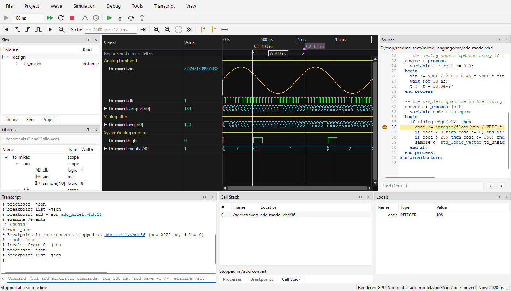
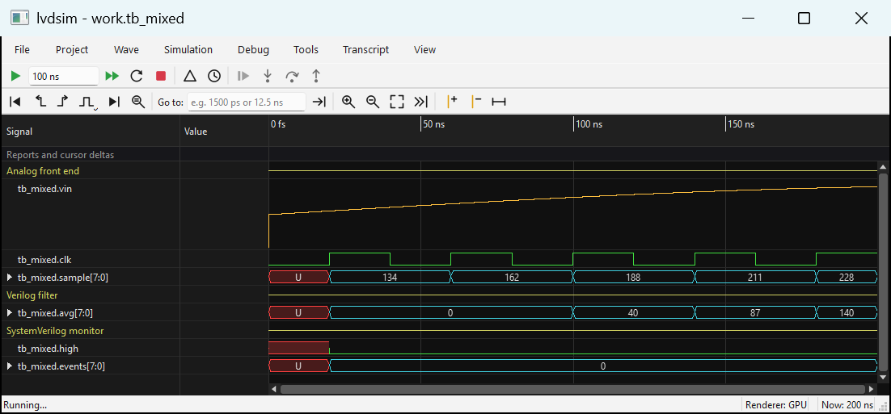
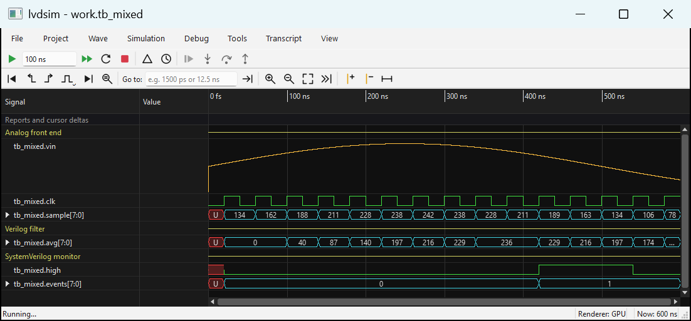

# lvdsim

lvdsim is an open-source HDL simulator front end with a **live waveform**: you start the window, add signals and press Run, and the
waveform draws itself *while the simulation advances*. There is no "simulate first, dump a file, open the waveform afterwards" step; the
window reads the kernel's output as a live stream, so rows appear and extend on screen as time moves on, and run, step and breakpoints act
on that same running session. (Live means the viewer follows the kernel; the simulation is not paced to wall-clock time and runs as fast
as the kernel can.) The simulation kernel is a small fork of the [NVC](https://github.com/nickg/nvc) VHDL simulator, always run as a
**child process** (`nvc -i`, never linked into the GUI). On top of it sit a Qt 6 Widgets application with a waveform viewer written from
scratch (a GPU renderer by default, with a QPainter tile renderer as the always-working fallback), the classic simulator command names
`vlib`, `vmap`, `vcom`, `vlog` and `vsim`, and a Tcl command layer (`add wave`, `run`, `force`, `examine`, ...).



The same window and the same session captured while the simulation runs (status bar `Now: 200 ns`, `600 ns`, then `2 us`; nothing is
reloaded between the captures; the [tutorial](docs/tutorial.md#2-run-a-design-in-the-gui-live) shows all three and a mid-run capture of a long run):




## Features


- **Live waveform**: the GUI starts the simulator as a child process and reads the waveform from a live stream while the simulation runs.
  Signals appear and extend as simulation time advances; there is no separate "simulate, write a file, open the waveform" step. You can
  add rows at any time (a new row shows its history from time 0), and run, step and time breakpoints act on the live session. FST is only
  for saving a trace. Live means the viewer follows the kernel; it does not pace the simulation to wall-clock time
  ([tutorial](docs/tutorial.md#2-run-a-design-in-the-gui-live)).
- **Languages**: VHDL up to 2008 (what NVC supports), Verilog and SystemVerilog **as far as vendor simulation models need them**,
  and mixed designs: VHDL testbenches that instantiate Verilog and SystemVerilog modules, compiled and elaborated together. `glbl`
  runs as a second top level (`vsim work.top work.glbl`). SystemVerilog classes, interfaces, UVM and testbench features are not supported
  (see Status).
- **Command line**: `vlib`, `vmap`, `vcom`, `vlog`, `vsim -c -do ...` accept the familiar option spellings and translate them to `nvc`;
  `lvdsim.ini` maps libraries. The Tcl package `tcl/compat/lvdcompat.tcl` provides `add wave`, `force`, `noforce`, `examine`, `log` and friends.
  See [docs/command-compat.md](docs/command-compat.md).
- **GUI** (`lvdsim-gui`): Library, Sim (structure), Project, Objects (with in/out/inout/buffer/internal icons), Processes, Source,
  Breakpoints, Call Stack, Locals, List, Memory, Coverage, Transcript and Wave docks; run, run -all, stop; time breakpoints; step delta
  and step time; drag signals from Objects to the wave, List or Memory window.
- **Source debugger**: click in the Source margin (or F9) for a line breakpoint, then Continue (F5), Step Into (F11), Step Over (F10)
  and Step Out (Shift+F11); the current line is marked, Call Stack and Locals show the frames and variables of the stopped process
  (changed values highlighted). Verilog `$stop` stops the same way.
- **Restart in place**: `restart` resets the running simulation to time 0 in about 20 ms, keeping breakpoints, forces, Tcl state and
  the wave setup; after a recompile the GUI starts a new process instead.
- **Waveform viewer**: from-scratch, driven by a level-of-detail index so zoomed-out views do not iterate events. Digital rows,
  buses with radix (binary, hex, octal, signed, unsigned, ASCII, enum), analog (`real`) rows with auto or manual range, groups, dividers,
  virtual buses, multiple cursors with delta labels, scroll bars and Follow (stay at the end of the run), wave format save and load
  (`add wave` script). Rows move, group, ungroup and rename by keyboard (Ctrl+Up/Down, Ctrl+G, F2), menu or drag and drop, with undo.
  Nothing is drawn after the time the run reached.
- **Search and navigation**: next/previous edge (any, rising, falling; Tab/Shift+Tab), Find value (Ctrl+F, F3) with radix values,
  wildcards and analog threshold crossings, Go to time.
- **Expression signals**: rows computed from other signals (`a and not b`, `bus = 16#3F`, `cnt > 100`, slices, concatenation),
  updated live and usable in search and the List window ([docs/expressions.md](docs/expressions.md)).
- **Datasets and compare**: open saved FST files next to the live run (`ref:/tb/x`), compare signals or whole scopes with a time
  tolerance, difference rows and next/previous difference.
- **List and Memory windows**: a time-by-signal table (1M rows, CSV export, `add list`); an address/data view of VHDL and Verilog
  memories at the cursor time or live, with search and `$readmemh` export (`add mem`). The shell can `deposit` into array elements and
  load a memory with `readmem`.
- **Coverage**: Simulation > Collect coverage (or `vsim -coverage`) and a Coverage dock with per-instance statement, branch, toggle,
  expression and FSM figures, uncovered lines marked in Source, merge of databases and the HTML report.
- **Projects and regressions** ([docs/projects.md](docs/projects.md)): a plain-text project file, import from a compile `.do` script,
  incremental recompile of changed files and their dependants, a Problems list, and a regression runner with parallel jobs, time-outs,
  rerun-failed, merged coverage and JUnit output (`lvdsim-cli regress`).
- **Console**: persistent history with Ctrl+R search, Tab completion of commands and design paths, multi-line commands, coloured
  messages and clickable `file:line` links, drop a `.do` file to run it.
- **Timing**: SDF back-annotation (`vsim -sdfmin/-sdftyp/-sdfmax`) for VITAL models and Verilog timing checks ([docs/sdf.md](docs/sdf.md));
  generic overrides `-g`/`-G`, also through generate labels.
- **Saved traces**: batch runs can save FST files (`-lvdwave`), read through our own Qt-free `libwave`.
- **Renderers**: the GPU renderer (QRhi, Direct3D 11 on Windows) is the default and falls back to the QPainter tile renderer by itself
  when the GPU cannot be used (remote desktop, virtual machine, offscreen). QPainter is always available and can be forced with
  View > Waveform renderer or `LVDSIM_RENDERER=cpu`. The status bar shows which one draws. Both are covered by pixel-comparison tests;
  at 4K the GPU renderer pans 3 to 5 times faster.
- **Reports**: every `report` and `assert` line in the transcript gets a clickable, severity-coloured time stamp, and a coloured arrow
  in the event band of the wave window ([docs/gui-reports.md](docs/gui-reports.md)).
- **Vendor libraries**: scripts and a GUI dialog (Tools > Compile libraries...) that compile **your own** Xilinx Vivado (unisim, unimacro,
  Verilog unisim, XPM) and Altera Quartus (altera_mf, lpm, sgate, altera_primitives, optional atoms) simulation libraries
  ([docs/libraries.md](docs/libraries.md)).
- **Packaging**: self-contained Windows folder, zip and Inno Setup installer; Linux self-extracting `.run` installer with a bundle that includes the GUI, Qt and nvc ([docs/packaging.md](docs/packaging.md)).

## Install on Linux

Download `lvdsim-<version>-linux-x86_64.run` and run it with sh (no root needed, nothing is downloaded):

    sh lvdsim-0.1.5-linux-x86_64.run

It verifies its SHA-256 checksum, installs into `~/.local/opt/lvdsim`, adds symlinks `lvdsim-gui lvdsim-cli vlib vmap vcom vlog vsim` to
`~/.local/bin`, and a menu entry with an icon. It does **not** edit your `PATH` or shell startup files unless asked: if `~/.local/bin`
is not on your `PATH` it prints the line to add (or install with `--add-path`). Useful options: `--prefix DIR`, `--yes`, `--no-symlinks`,
`--no-desktop`, `--add-path`, `--uninstall`, `--extract DIR` (unpack only), `--check`, `--list`, `--license`, `--help`. Everything is
self-contained (Qt, LLVM, Tcl, nvc); only glibc and the GPU/OpenGL libraries come from your system. Details, the layout and the licence
notices: [docs/packaging.md](docs/packaging.md#linux).

## Quick start

### From the package

Unzip `lvdsim-0.1.5-win64-portable.zip` (a portable copy: settings and compiled libraries stay in its `data` folder), or run the installer (its "Add lvdsim to the PATH" box is ticked by default). Nothing else is needed:
nvc, its libraries and the Tcl package are inside. In a terminal, for this session:

```bat
set PATH=C:\tools\lvdsim-0.1.5-win64-portable;%PATH%
cd examples\mixed_language
vlib work
vlog -work work src\avg_filter.v
vlog -sv -work work src\level_monitor.sv
vcom -2008 -work work src\adc_model.vhd src\tb_mixed.vhd
lvdsim-gui -do sim.do work.tb_mixed
```

The last command opens the window shown above, adds the rows and runs 2 us while you watch (the waveform is not read from a file).
`lvdsim-gui work.tb_mixed` starts the same design at time 0 and waits for your commands (`add wave /clk`, `run 200 ns`, ...). For a run
without a window (scripts, regressions):

```bat
vsim -c -do "run 2 us; puts [list events [examine /events] avg [examine /avg]]; quit" work.tb_mixed
```

It prints `events {"00000010"} avg {"00101110"}`.
The examples are in this repository, not in the package. Each example folder also has `run.sh` and `run.bat`: with no argument they compile
the design and open the GUI with the example's `sim.do` (close the window to end the run); with `--batch` they run without a window and print the
result line (`run.bat --batch` above). With the package folder on `PATH`: `cd examples\mixed_language` and `run.bat`. See
[examples/README.md](examples/README.md).

The wave window uses the GPU renderer when it can and the status bar says `Renderer: GPU`. If it says `Renderer: QPainter (GPU not
available: ...)`, drawing still works, only slower at 4K. To force the QPainter renderer (remote desktop, virtual machine, driver
trouble) set `LVDSIM_RENDERER=cpu` or choose View > Waveform renderer > QPainter only.

### From source

Needs Qt 6.11 (MinGW kit), CMake, Ninja, and the NVC fork built with `kernel/build/build-nvc-msys2.sh`:

```sh
cmake --preset mingw-debug
cmake --build --preset mingw-debug
ctest --preset mingw-debug
```

Programs are written to `build/mingw-debug/bin`. How to point them at the kernel from the build tree is in
[docs/tutorial.md](docs/tutorial.md) (section 1) and [examples/README.md](examples/README.md).

## Build from source on Linux

Tested on Debian 13 in WSL. Full steps, the package list, troubleshooting and the bundle/installer build are in
[docs/building-linux.md](docs/building-linux.md).

```sh
sudo apt install build-essential cmake ninja-build pkg-config flex bison autoconf automake libtool check llvm-dev libffi-dev   libzstd-dev zlib1g-dev libncurses-dev tcl-dev libreadline-dev git xz-utils   qt6-base-dev qt6-base-private-dev qt6-shadertools-dev qt6-svg-dev libgl-dev libvulkan-dev patchelf
# the NVC kernel: clone of the lvdsim branch of the fork (kernel/build/fetch-nvc.sh), then build it, see the guide
cmake --preset linux-release -DLVDSIM_BUILD_GUI=ON
cmake --build --preset linux-release -j"$(nproc)"
export QT_QPA_PLATFORM=offscreen LVDSIM_NVC=$HOME/build/nvc-linux/bin/nvc LVDSIM_NVC_LIBDIR=$HOME/build/nvc-linux/lib
ctest --preset linux-release
```

## Documentation

- [Tutorial](docs/tutorial.md): install, the live GUI flow, tour of the window, reports, vendor libraries, batch flow, common problems
- [Command compatibility](docs/command-compat.md)
- [Projects and regressions](docs/projects.md)
- [Expression signals](docs/expressions.md)
- [SDF back-annotation](docs/sdf.md)
- [Changelog](CHANGELOG.md)
- [Vendor libraries](docs/libraries.md)
- [Building on Linux](docs/building-linux.md)
- [Packaging](docs/packaging.md) and [making a release](docs/packaging.md#making-a-release) (one command each for Windows and Linux)
- [Kernel regression tests](docs/kernel-tests.md)
- [Verilog and XPM coverage](docs/verilog-coverage.md)
- [GUI to kernel protocol](docs/protocol.md)
- [HDL reports in the GUI](docs/gui-reports.md)
- [Examples](examples/README.md)

## Licence

lvdsim is licensed under **GPL-3.0-or-later**. Third-party components:

| Component | Licence | Use |
|-----------|---------|-----|
| NVC (the `lvdsim` branch of the fork, `kernel/PATCHES.md`) | GPL-3.0-or-later | separate program, started as a child process |
| Qt 6.11 (Core, Gui, Widgets, Network, Svg) | LGPL-3.0 | dynamically linked, unmodified DLLs the user can replace; no GPL-only Qt modules |
| fstapi (libfst) | MIT | vendored, waveform file reading and writing |
| Catch2 | BSL-1.0 | unit tests only |

The Xilinx and Altera simulation libraries are **never redistributed**: the scripts read them from your own Vivado or Quartus installation
and write compiled libraries only to a folder you choose. Check the vendor's licence before sharing the result. The full licence texts and
notices ship in the `licenses/` folder of the packages. Binary distribution of the patched NVC must be accompanied by its corresponding
source (see [docs/packaging.md](docs/packaging.md)).

## Acknowledgements

lvdsim would not exist without **[NVC](https://github.com/nickg/nvc)**, the VHDL compiler and simulator written by **Nick Gasson**
and contributors (GPL-3.0-or-later). All HDL compilation, elaboration and simulation is done by NVC, run as a separate program; this
project adds a front end and a small, documented set of changes on a branch of an NVC fork ([`kernel/PATCHES.md`](kernel/PATCHES.md)) written in the upstream
style, with the intention of offering the generic ones back. Upstream copyright notices are kept untouched. Please report problems
in the unmodified NVC behaviour to the NVC project, and problems in this front end or in our kernel changes here.

Thanks also to the authors of Qt, fstapi (libfst) and Catch2.

## Status and limitations

lvdsim is at version 0.1.5. What does not work yet:

- **Platforms**: Windows and Linux
- **SystemVerilog** is supported for vendor models only: modules, `logic`, `always_ff` and `always_comb`, enums, packed structs, generate,
  tasks, programs. Classes, interfaces and modports, packages with `import`, queues, associative arrays, `fork`/`join`, concurrent assertions,
  covergroups and DPI do not work; UVM is a non-goal. VHDL-2008 is the testbench language.
- **Xilinx models**: all 428 Verilog unisim files compile and 318 models run; about 110 are wrappers of encrypted secureip modules
  (transceivers, PCIe, hard IP) that cannot be simulated. `xpm_memory_*` and `xpm_fifo_*` with block memory work; MMCM/PLL output
  frequency is open ([docs/verilog-coverage.md](docs/verilog-coverage.md)). Tested with Vivado 2022.2 only.
- **Altera models**: the VHDL libraries compile and the basic megafunctions behave; the Verilog `220model.v` (33 of 33 models) and `altera_mf.v`
  (113 of 113, including `altsyncram`) run; the `twentynm` and `cyclone10gx` atoms analyse (19 of 66 run, most others need encrypted modules).
  `altera_lnsim.sv` and `tennm_atoms.sv` do not analyse yet (strings, classes). Tested with Quartus Pro 24.2 only ([docs/libraries.md](docs/libraries.md)).
- **SDF**: Verilog module path delays (IOPATH, INTERCONNECT) and `$width`/`$period` are not annotated yet; INCREMENT, COND and bus
  bit selects are skipped with a warning ([docs/sdf.md](docs/sdf.md)).
- **Debugger**: no conditional breakpoints; locals of functions and of procedures that cannot wait are not shown; Verilog variables
  are read with `examine` rather than Locals.
- **OSVVM, UVVM and cocotb** are untested; their flows were deferred.
- **Kernel features still open**: runtime dump control; `when` conditions; reloading a recompiled design without a new process;
  encrypted IP (IEEE 1735) is out of scope. `examine` cannot print `real` signals; look at them in the wave window.
- **GPU renderer**: tested on Direct3D 11 only (on Linux it is untested and falls back to QPainter in WSL); on high-DPI screens it is
  slightly softer than the QPainter renderer.
- Big runs are slow: the 10 000 signal stress example takes about 90 s for 20 ms of simulated time at 50 MHz.
