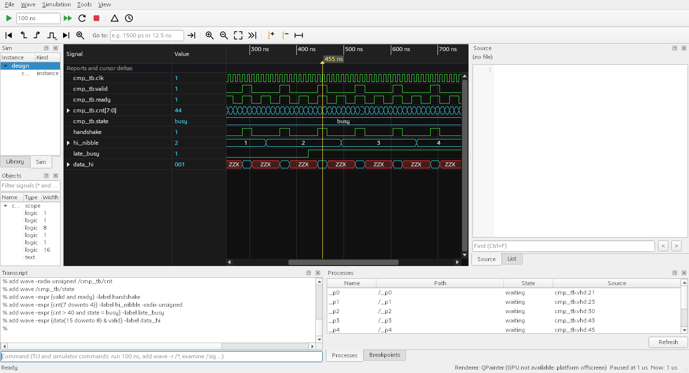
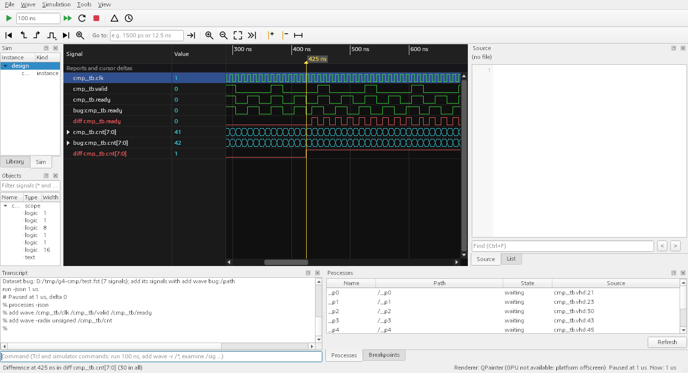

# Expression signals, datasets and waveform compare

The wave window can show rows that were never recorded: an **expression signal** computes a value from other
signals (`valid and ready`, `cnt > 100`, `data(15 downto 8)`), and a **compare row** shows where a signal of one
waveform differs from the same signal of another. Other waveforms are opened as **datasets** next to the running
simulation. All the computing is in libwave (`lvdwave/expression.hpp`, `lvdwave/compare.hpp`,
`lvdwave/wave_space.hpp`); the results are ordinary signals, so drawing, zooming, the edge and value searches, analog
display and the List window treat them like recorded ones.

## Adding an expression row

- Wave window context menu or **Wave** menu > **Add expression signal...**: a name and the expression. The text is
  checked while you type; the line under it shows the error and its column (`col 9: unknown signal 'vld'`) or the type
  of the result (`1 bit`, `8 bit vector`, `real`, `text`). OK is enabled only for an expression that works.
  **Insert signal...** puts the path of a wave row at the text cursor.
- Double-click the name of an expression row (or **Edit expression...** in its context menu) to change it.
  Delete removes it like any row; both are one undo step.
- From the console or a `.do` file: `add wave -expr {valid and ready} -label handshake`. Brace the expression so that
  Tcl does not read `[`, `$` or `;` in it. An expression that does not compile is reported in the transcript and no row
  is added. `add list -expr {cnt > 100} -label big` adds it as a List column.
- Expression rows take a radix, a colour, the analog display and "Show bits" like signal rows, and are saved in the
  wave layout (`expr` statement, see display-format.md) and in the wave format (`add wave -label ... -expr {...}`).

During a run the rows follow the simulation: each update reads only the changes that arrived since the previous
one. A row ends where the shortest of its inputs ends (a row that reads a longer dataset still stops at the end of
the run).

## The expression language

Names, literals and operators follow VHDL, with the common C style spellings accepted as well. Keywords are not case
sensitive.

**Names.** A signal is named as `add wave` names it: `/tb/dut/q`, `tb.dut.q`, or relative to the design top, `q`.
A vector recorded as `count[7:0]` is `count`. A dataset signal has the dataset name in front: `ref:/tb/dut/q`.
Wildcards are not allowed, and a name that matches more than one signal is refused.

**Values.**

| Written as | Meaning |
|---|---|
| `100` | a decimal number (as wide as it needs to be) |
| `16#3F#`, `16#3F`, `8#17#`, `2#0101#` | based numbers; base 2, 8 and 16 give one digit per 1, 3 or 4 bits |
| `x"3F"`, `o"17"`, `b"0101"`, `"0101"` | bit strings (`_` separators allowed; `X`, `Z`, `U` digits too) |
| `0x3F`, `0b101`, `8'h3F`, `4'b10x1`, `'hFF` | the same in C and Verilog notation |
| `'1'`, `'0'`, `'X'`, `'Z'` | one bit |
| `1.5`, `2e-3` | a real number |
| `true`, `false` | `'1'`, `'0'` |
| `IDLE`, `"run"` | compared with an enumeration (text) signal: the literal text |

**Operators**, from the tightest to the loosest binding:

| Operators | Result |
|---|---|
| `a(3)`, `a(7 downto 4)`, `a(4 to 7)`, `a[3]`, `a[7:4]` | bits of a vector; bit 0 is the least significant bit, whatever the declared range |
| `not a`, `~a` | bit by bit |
| `!a` | one bit: true when no bit of `a` is 1 |
| `-a` | two's complement |
| `a + b`, `a - b` | unsigned (or signed, see below) sum and difference, as wide as the wider operand; a real operand makes a real |
| `a & b`, `{a, b, c}` | concatenation, `a` in the most significant bits |
| `=`, `==`, `/=`, `!=`, `<`, `<=`, `>`, `>=` | one bit; vectors compare as numbers |
| `===`, `!==` | one bit, never unknown: equal when every bit is equal (`X` equals `X`) |
| `and`, `nand`, `&&` | |
| `xor`, `xnor`, `^` | |
| `or`, `nor`, `|`, `||` | |

Parentheses group. `signed(a)` makes `a` compare and extend as a two's complement number (`signed(bus) < 0`);
`unsigned(a)` is the default.

**Unknown values.** Bits are nine-valued like `std_logic` (L and H count as 0 and 1). Bitwise operators follow the
usual tables: `'0' and 'X'` is `'0'`, `'1' and 'X'` is `'X'`. A comparison or a sum with an unknown bit is `X`
(`U` if a `U` is involved), except `===` and `!==`. Before its first change a signal reads as all `U`. `&&`, `||`
and `!` take an operand as true when any bit is 1, false when all bits are 0, unknown otherwise.

**Widths.** Bitwise operators and comparisons extend the narrower operand with zeros (with its sign bit after
`signed()`), so `bus = 5` works for any width of `bus`. A comparison of a vector with a number wider than the vector
is simply false.

**Not in the language (yet):** multiplication and division, shifts, reduction operators other than `!`, edge
functions such as `rising(clk)` (use the rising-edge navigation on a one bit row instead), references to other
expression rows.

## Datasets

**File > Open dataset...** opens a finished FST file next to the simulation (several can be open). Its name is the
file name without extension (`ref.fst` becomes `ref`); its signals are written `ref:/tb/dut/q` in commands and
expressions and shown as `ref:tb.dut.q` in the wave window.

- `add wave ref:/tb/dut/*` adds dataset signals; the wave window context menu has **Add from dataset > ref**, which
  adds the dataset's copy of every selected signal right below it.
- A file the running simulation is still writing is refused (an FST file can only be read once it is closed), as is a
  second dataset with a name already in use. A file with another time unit is converted to the simulation's unit.
- **File > Close dataset** removes it; rows that show its signals stay and are drawn as missing until a dataset of the
  same name is opened again.
- The view covers the longest waveform; every row ends where its own waveform ends.
- Headless: `lvdsim-gui ... --dataset ref=ref.fst` (and `lvdsim-wave-demo file.fst --dataset ref ref.fst`).

## Comparing waveforms

A **compare row** is a red one-bit row that is high while a reference signal and a test signal hold different
values.

- **Compare with dataset > ref** (context menu) adds, below every selected signal, the dataset's copy and the compare
  row (reference = dataset, test = simulation).
- **Compare waveforms...** compares two whole waveforms (the simulation or any dataset as reference and as test),
  optionally below one scope (`/tb/dut`), and adds a group with a compare row for every signal that differs (up to
  200). The status bar gives the summary: signals compared, how many differ, the number of differences, and the
  signals found in only one of the two.
- `add wave -compare [-label L] [-tolerance T] REF TEST`: the two patterns must match the same number of signals
  and are paired in order, e.g. `add wave -compare ref:/tb/dut/* /tb/dut/*`.
- **Next difference** / **Previous difference** (context and Wave menu) move the active cursor to the start of the
  next or previous difference of the selected compare rows (all compare rows if none is selected); the status bar
  says which row and how many differences there are in all. A compare row is also an ordinary one bit row, so the
  rising and falling edge buttons and Find value work on it.

Rules: values are compared per time step (delta cycles at one time count as one step with the last value). Logic
values are equal when every bit is equal after zero extension, with L equal to 0 and H equal to 1 (`X`, `Z`, `U`
only equal themselves); text must be identical; reals may get an absolute tolerance in the library
(`CompareOptions::realTolerance`, not in the GUI yet). The comparison runs up to the end of the shorter of the two
waveforms, and follows a running simulation.

**Time tolerance.** Differences that last the tolerance or less are ignored, so an edge that moved by up to the
tolerance is not reported (`-tolerance {2 ns}`, the *Time tolerance* field). 0 reports every difference.

## Performance

`bench_expression` (libwave/bench, release build, one million changes per input signal, inputs changing at different
times, so `k` inputs give about `k` million time steps):

| Expression | One call | In 1000 chunks (live) | ns per step |
|---|---|---|---|
| `a and not b` | 37 ms | 35 ms | 18 |
| `bus = 16#3F` | 65 ms | 65 ms | 65 |
| `cnt > 100000` (32 bit) | 103 ms | 102 ms | 103 |
| `bus(7 downto 4) & a` | 98 ms | 98 ms | 49 |
| `(bus(3 downto 0) = 5) or (a and b)` | 113 ms | 112 ms | 38 |
| `cnt(7 downto 0) + bus(7 downto 0)` | 182 ms | 182 ms | 91 |

Comparing two signals of a million changes each takes 5 ms (one bit) to 70 ms (32 bit); a whole store of four such
signals 100 ms. Evaluation and comparison are linear in the number of changes and are done once; drawing uses the
same tile cache and level of detail as recorded signals.
