# lvdsim tutorial

This walk-through takes a new user from an unpacked download to a design that is **simulating in front of you**: you compile
once, start the window, add signals and press Run, and the waveform draws itself while the simulation advances. There is no
"simulate first, write a dump file, open the waveform afterwards" step. It then covers a tour of the window, the HDL report links, the
Xilinx and Altera library helpers and, later, the command-line (batch) flow. Every command below was run on Windows 11 while writing
this page, and the output you see is what the program printed. The screenshots are real captures of `lvdsim-gui`.

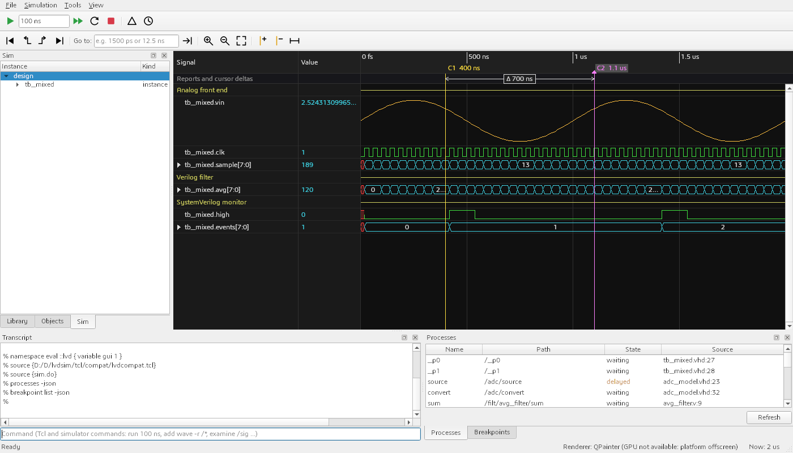

> **Live waveform.** `lvdsim-gui` starts the simulator as a child process and reads the waveform from a live stream while the
> simulation runs. Signals appear and extend on screen as simulation time advances, `run`, `step` and breakpoints act on that same
> session, and you can add rows at any time. "Live" means the *viewer follows the kernel*; it does **not** mean the simulation is
> paced to wall-clock time. The kernel runs as fast as it can. Section 2 shows the same window captured while a run is in
> progress. FST files are only for saving a trace ([section 6](#6-the-command-line-and-batch-flow)).

Contents: [1 Install](#1-install) - [2 Run a design in the GUI, live](#2-run-a-design-in-the-gui-live) -
[3 Tour of the window](#3-tour-of-the-window) -
[4 Reports in the transcript and the event band](#4-reports-in-the-transcript-and-the-event-band) -
[5 Vendor libraries](#5-vendor-libraries) - [6 The command line and batch flow](#6-the-command-line-and-batch-flow) -
[7 Common problems](#7-common-problems) - [8 Where to go next](#8-where-to-go-next)

The examples are in the source tree (`examples/`), not in the Windows package. Clone or download the repository, even if you
use the packaged programs.

## 1. Install

### From the zip

`lvdsim-0.1.0-win64-portable.zip` is a self-contained folder (about 215 MB unpacked, most of it LLVM for the NVC JIT). Unpack it anywhere:

```powershell
Expand-Archive lvdsim-0.1.0-win64-portable.zip -DestinationPath C:\tools
```

Nothing is installed and nothing is written to the registry (see [Portable use](#portable-use)). The programs find `nvc`, its libraries
and the Tcl command package relative to their own location, so no environment variables are needed. To type `vcom` or `vsim` in a
terminal, put the folder on `PATH` for that terminal only:

```bat
set PATH=C:\tools\lvdsim-0.1.0-win64-portable;%PATH%
```

Put the folder **before** the rest of `PATH` (see [problem 1](#7-common-problems)). Do not put `nvcin` on `PATH`: nvc uses MSYS2
runtime DLLs that clash with the Qt runtime of the other programs.

### From the installer

`lvdsim-0.1.0-win64-setup.exe` installs the same folder, per user by default (`%LOCALAPPDATA%\Programs\lvdsim`, no administrator
rights) or for all users if you choose that in the first dialog. The **Select Additional Tasks** page has two check boxes:

- **Add lvdsim to the PATH (vlib, vmap, vcom, vlog, vsim and lvdsim-cli)**: ticked by default. It appends the install folder (never
  `nvc\bin`) to the user `PATH`, or to the system `PATH` for an all-users install, once; reinstalling does not add it twice and
  uninstalling removes only that entry. Untick it if you prefer to set `PATH` per terminal as above. Terminals that were already open
  keep the old `PATH`: open a new one after the installer finishes.
- **Create a desktop icon**: unticked by default.

(No screenshot of the installer pages is shown: it was tested silently, per user, on the development machine, never as an all-users install; the
behaviour is described in [packaging.md](packaging.md).)

### Portable use

The zip (and the Linux `-portable.tar.gz`) contains a file `portable.txt` next to `lvdsim-gui`. While it is there the program keeps
everything it saves inside its own folder:

- `data\lvdsim-gui.ini` holds the window layout and options (nothing goes to the registry or to `~/.config`);
- `data\libraries` is the default output folder of **Tools > Compile libraries**.

So you can unzip anywhere, carry the folder on a USB stick, and your settings and compiled libraries travel with it. Do not run it from a
read-only location (a DVD, a locked share): the window then falls back to the normal per-user settings and says so in the transcript.
Temporary files still use the system temp folder. Delete `portable.txt` to switch the mode off, or set `LVDSIM_PORTABLE=1` to switch it on
for a copy that has no marker. `lvdsim-gui --settings FILE` always wins. The installer's copy has no `portable.txt` and uses the normal
per-user settings.

### From the Linux installer

`lvdsim-0.1.0-linux-x86_64.run` is a shell script with the program bundle appended (about 70 MB, Qt and nvc included; it needs glibc 2.38
or newer, for example Ubuntu 24.04 or Debian 13, and `xz` to unpack). Run it as your normal user:

```sh
sh lvdsim-0.1.0-linux-x86_64.run
```

It prints the licence summary (GPL-3.0-or-later), checks its checksum and installs into `~/.local/opt/lvdsim`. It creates symlinks
for `lvdsim-gui`, `lvdsim-cli`, `vlib`, `vmap`, `vcom`, `vlog` and `vsim` in `~/.local/bin`, a menu entry `lvdsim` and its icon under
`~/.local/share`. Your `PATH` and shell startup files are **not** changed; if `~/.local/bin` is not on your `PATH` the installer says so
and prints the line to add:

```sh
export PATH="$HOME/.local/bin:$PATH"
```

(or install with `--add-path`, which appends a clearly marked block to `~/.profile` and `~/.bashrc`). Other options: `--prefix DIR`,
`--yes`, `--no-symlinks`, `--no-desktop`, `--extract DIR` (unpack without installing), `--check`, `--list`, `--license`.
To remove lvdsim: `sh lvdsim-0.1.0-linux-x86_64.run --uninstall` (add `--prefix DIR` if you used one); it removes exactly what the
installer created. Without installing you can also run `sh lvdsim-0.1.0-linux-x86_64.run --extract ~/lvdsim` and then `~/lvdsim/AppRun`
(the GUI) or `~/lvdsim/AppRun --run vsim ...`. On a machine without a desktop session use `QT_QPA_PLATFORM=offscreen lvdsim-gui ...`.

### From source

You need Qt 6.11 (MinGW kit), CMake, Ninja and the NVC fork built with MSYS2 (`kernel/build/build-nvc-msys2.sh`). From a Git Bash
in the repository root:

```sh
export PATH="/c/Qt/Tools/mingw1310_64/bin:/c/Qt/Tools/Ninja:/c/Program Files/CMake/bin:$PATH"
cmake --preset mingw-debug
cmake --build --preset mingw-debug
ctest --preset mingw-debug
```

Everything lands in `build/mingw-debug/bin` (`lvdsim-gui`, `lvdsim-cli` and its copies `vlib vmap vcom vlog vsim`). A build-tree run has
to be told where nvc is. Set this up once per shell; the rest of this tutorial assumes it whenever it says "build tree":

```sh
B=$PWD/build/mingw-debug/bin
K=$PWD/kernel/nvc/build
export PATH="$B:/c/msys64/mingw64/bin:/c/Qt/6.11.1/mingw_64/bin:/c/Qt/Tools/mingw1310_64/bin:$PATH"
export LVDSIM_NVC=$K/bin/nvc.exe
export LVDSIM_NVC_LIBDIR=$K/lib
export LVDSIM_NVC_DLLDIR=C:/msys64/mingw64/bin
```

The MSYS2 directory must come before Qt's MinGW directory. In a Windows command prompt the equivalent `set` lines are in
[examples/README.md](../examples/README.md), section 1.

## 2. Run a design in the GUI, live

`examples/mixed_language` is a small mixed-language design with no third-party code: a VHDL analog source (a sine on a `real`
signal) and 8-bit ADC, a Verilog moving-average filter, a SystemVerilog threshold monitor, and a VHDL testbench. The example also puts
real-valued (analog-style) signals next to digital logic; there is no analog solver.

**PATH for this section:** either the package folder (programs find nvc themselves) or the build-tree setup of section 1.

### 2.1 Prepare the design (once)

The window simulates compiled libraries, and it does not compile your sources when it starts. Compile from a terminal first;
Verilog and SystemVerilog before VHDL, so that VHDL can instantiate them:

```sh
cd examples/mixed_language
vlib work
vlog -work work src/avg_filter.v
vlog -sv -work work src/level_monitor.sv
vcom -2008 -work work src/adc_model.vhd src/tb_mixed.vhd
```

`vlib` prints `Creating library 'work'.` (`Library 'work' already exists.` if you run it again); the compilers print nothing when
everything is fine. This is all the preparation there is: you do **not** run a simulation at this point. (Once a simulation is
running, `vlib`, `vmap`, `vcom` and `vlog` can also be typed in the transcript line of the window; they run the same tools and the
Library dock refreshes. The window itself cannot start without a compiled design.)

The example folder has `run.sh` and `run.bat` that do this compile step and then start the window of section 2.2 with `sim.do` in one go
(`examples/mixed_language/run.sh`, or `run.bat`); closing the window ends the run. `run.sh --batch` is the batch flow of
[section 6](#6-the-command-line-and-batch-flow). The commands are spelled out here so that you see each step.

### 2.2 Start the window

```sh
lvdsim-gui work.tb_mixed
```

`vsim work.tb_mixed` without `-c` does the same: it starts `lvdsim-gui`. The window opens at time 0 with an empty wave area. The
simulator is already running as a child process (the transcript shows its banner), waiting for your commands. Signal paths start at
the testbench instance: write `/clk`, not `/tb_mixed/clk`.

### 2.3 Add waves, run, and watch the waveform grow

Type these lines in the transcript (the line at the bottom of the window), one after the other:

```
% add wave /clk /sample /avg /events
% run 200 ns
% run 400 ns
% run 1400 ns
```

Each `run` advances the same simulation from where it stopped, and every row grows to the right as the time moves on. Nothing is
reloaded or refreshed, and no file is opened. The same rows can come from a script: `lvdsim-gui -do sim.do work.tb_mixed`, where
`sim.do` is a plain script that adds the rows and runs 2 us:

```tcl
add wave -divider {Analog front end}
add wave -format analog-interpolated -height 80 -min 0 -max 3.3 /vin
add wave /clk
add wave -radix unsigned /sample
...
run 2 us
```

The three captures below are **one window of one session**. A script ran `run 200 ns`, waited six seconds, ran `run 400 ns`, waited
six seconds and ran the rest, and the window was captured (the window only, with the transcript cropped out) during each wait. Look at
the ruler and at the `Now:` field of the status bar: 200 ns, 600 ns, then 2 us.

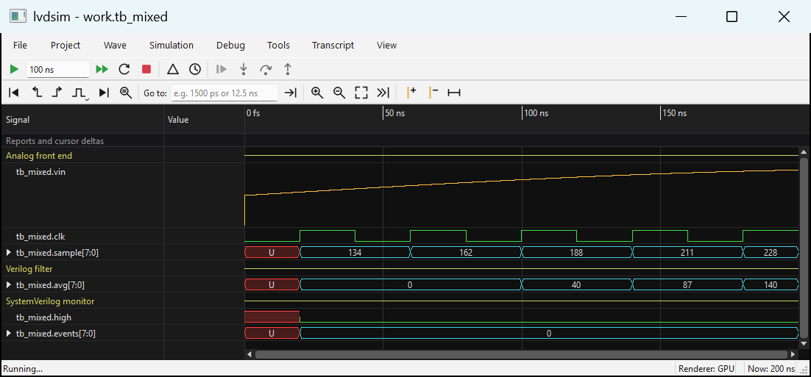

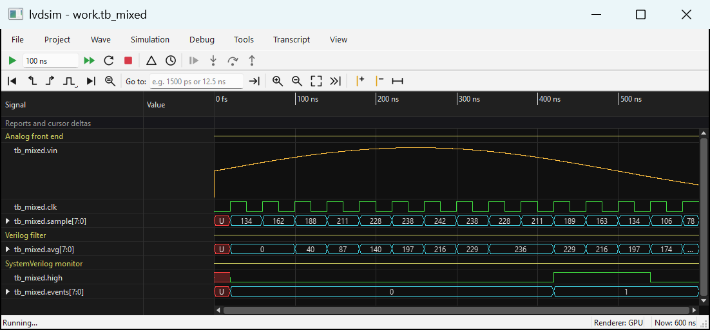

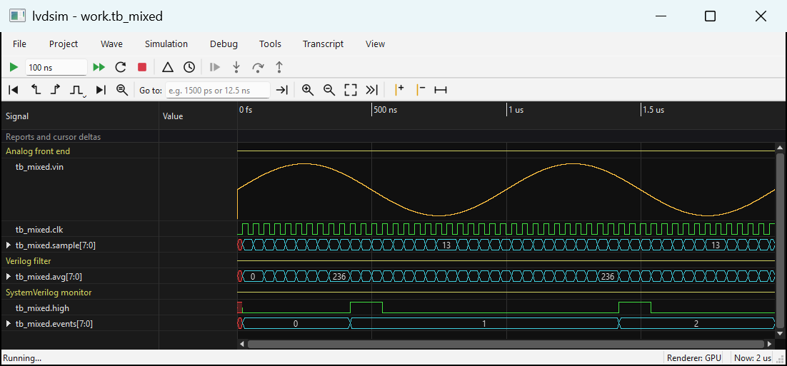

(The status bar says `Running...` in all three because the script was still executing between the runs.) With `-do sim.do` or `run -all`
the same thing happens without pauses: the waveform is drawn as the kernel produces it.

### 2.4 A long run: the waveform follows the kernel

The captures above are short runs. For a longer one, the `stress_10k` example was started with 30 lanes
(`-g N_LANES=30`, a startup script ending in `run 20 ms`) in a real window on Windows (the release build, QPainter renderer) and the
window was captured while the run was still going on, a few seconds apart. `Running...` and the `Now:` field of the status bar
come from the program, the ruler rescales as the stream grows:

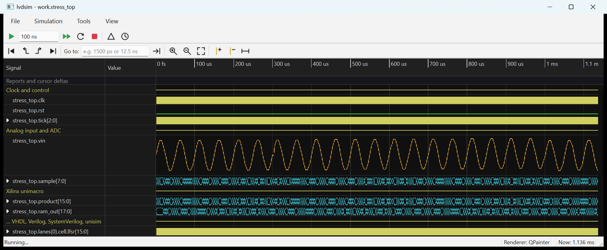

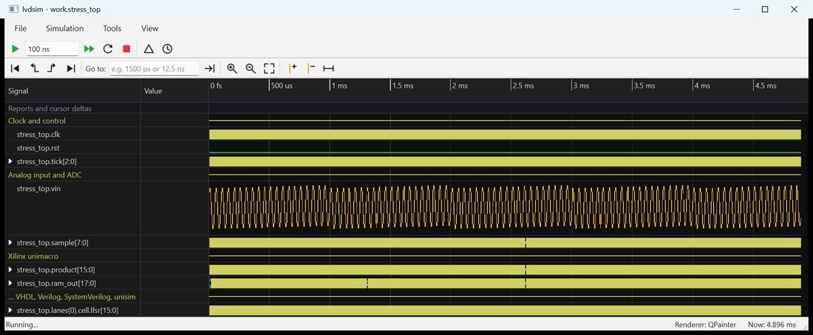

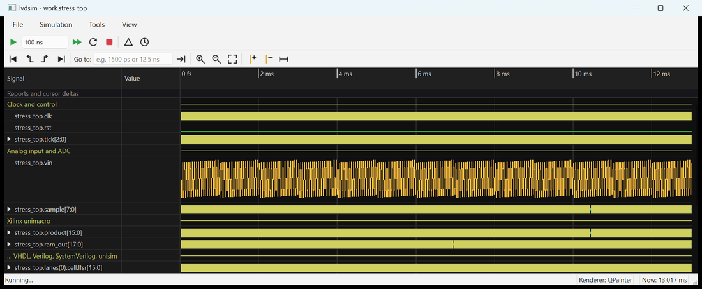

All three are the same window and the same session; nothing was reloaded in between. The run had not finished in any of them.

### 2.5 What "live" means, and what it does not

- **How it works.** The window starts `nvc` as a child process and asks it to write its waveform as a live stream (`--format=live`)
  into a temporary file. The kernel writes the design hierarchy first and then every value change, appending, and flushes it when a
  `run` ends and whenever its output buffer fills during a long run. The window reads what was appended about every 60 ms and adds it to
  an in-memory store that the wave pane draws from. The whole design is streamed, so a row added later with `add wave` shows its full
  history from time 0. Details: [protocol.md](protocol.md).
- **What you get.** Run, run -all, step delta, step time and time breakpoints act on the live session ([section 3](#processes-source-and-breakpoints-stepping)).
  After a pause you can add or change rows, move cursors, zoom, and continue. Stop ends the simulation; the waveform stays on screen.
- **What it does not mean.** The simulation is not slowed to real time, and it is not faster than the kernel: a big design simulates
  as slowly as before (the 10 000 signal example takes about 90 s for 20 ms of simulated time). The viewer follows the kernel; during
  a long run the new data arrives in chunks as the stream is flushed.
- **Saving a trace.** FST is only a file format for saving: `-lvdwave file.fst` in batch mode ([section 6](#6-the-command-line-and-batch-flow)).
  The GUI never reads FST while it is being written.

## 3. Tour of the window

The layout follows the familiar simulator arrangement: Library, Sim (design structure) and Objects docks on the left, the Wave window
in the middle, Source on the right, Transcript, Processes and Breakpoints along the bottom. Every dock can be closed, floated and
brought back with the **View** menu.

### The wave window

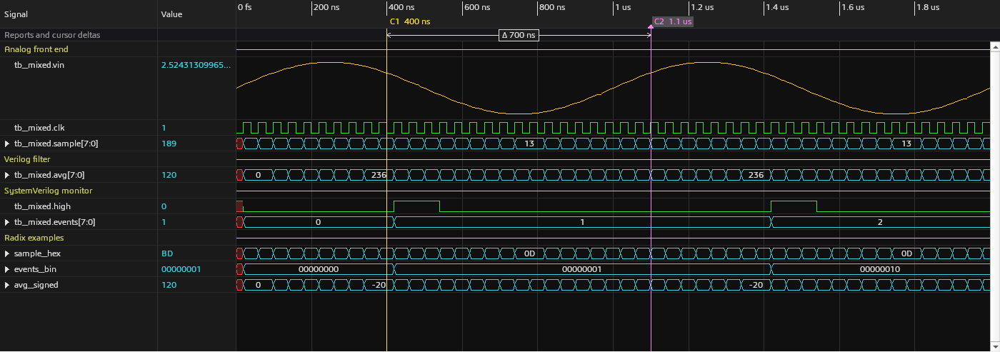

- **Analog row**: `add wave -format analog-interpolated -height 80 -min 0 -max 3.3 /vin` draws a `real` signal as a trace
  (`analog-step` gives a staircase). There is no `-analog` option.
- **Buses** show their value in the bar when it fits; click the triangle to expand a bus into its bits. Undefined values (`U`, `X`) are
  drawn red.
- **Radix**: `add wave -radix hexadecimal|binary|signed|unsigned|ascii ...` (shown above as `sample_hex`, `events_bin`,
  `avg_signed`). `-label` renames a row, `-divider` adds a yellow separator line.
- **Cursors** (toolbar buttons `|+` and `|-`, shift-click in the wave, or `--cursor` on the command line): the value column shows each signal at cursor 1.
  With two cursors, the band between the ruler and the first row carries the labels `C1 400 ns`, `C2 1.1 us` and the delta
  `700 ns`. The same band holds the report arrows of [section 4](#4-reports-in-the-transcript-and-the-event-band), so labels never cover a wave.
- Zoom with the magnifier buttons (or `+`, `-`, `F`), **Go to:** accepts `1500 ps` or `12.5 ns`.

#### Arranging signals: groups, dividers, rename, move

Select rows in the name column (click, Ctrl-click, Shift-click; the Up and Down arrows walk the selection) and arrange them.
Everything is also in the **Wave** menu and in the context menu (right click on a row).

| Keys | What it does |
|---|---|
| Ctrl+Up / Ctrl+Down | move the selected rows up or down among their siblings (a group moves with its rows) |
| Ctrl+Shift+Up / Ctrl+Shift+Down | move to the top or the bottom of their group |
| Ctrl+G / Ctrl+Shift+G | wrap the selection in a new group (`Group`, `Group 2`, ...) / replace the selected groups by their rows |
| F2 | rename the group, divider, bus or signal label in place (Enter applies, Escape cancels; a group needs a name, a divider may be empty) |
| Ctrl+Z / Ctrl+Y (or Ctrl+Shift+Z) | undo / redo these edits, 100 steps |
| Del | remove the selected rows (a group takes its rows with it) |

The context menu adds **Move to group** (any existing group, *Top level*, or *New group...*), **Insert divider above / below**
(the new divider opens its name editor) and **Ungroup**. You can also **drag** rows by the name column: a blue line shows where
they land, a highlighted group row means "into this group", the list scrolls when you hold the pointer near the top or bottom edge,
Escape cancels, and a group cannot be dropped into itself. Dropping outside the name column does nothing.

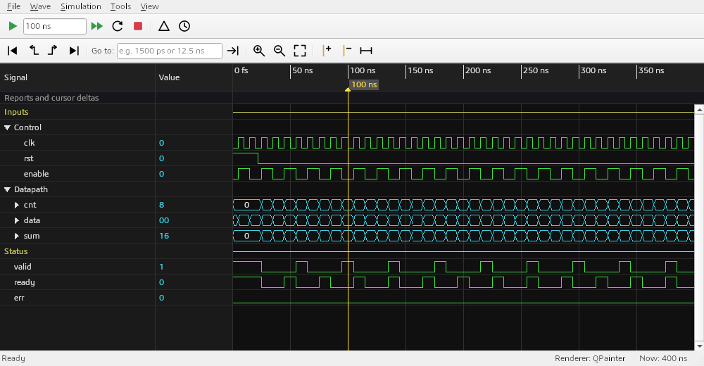
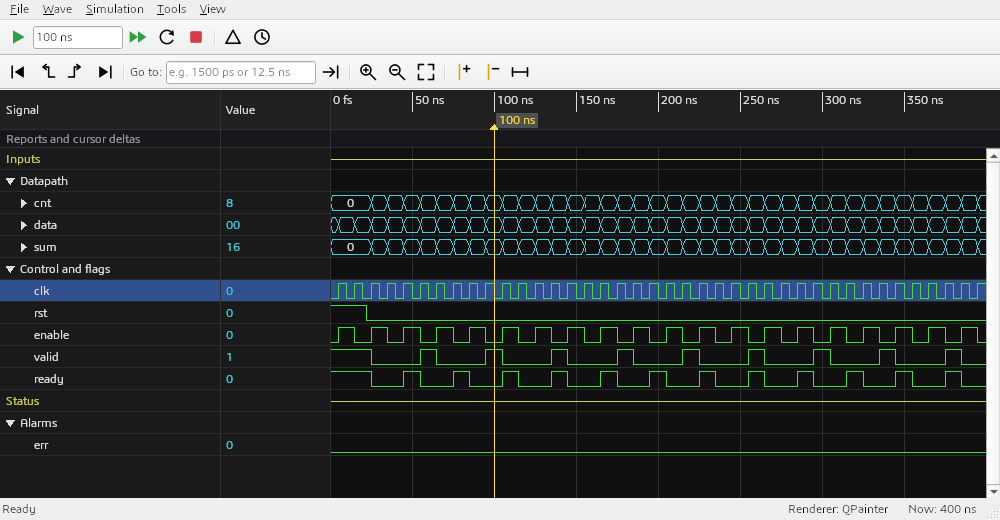

Renaming a group opens an editor over its row, and the context menu holds the arranging commands:

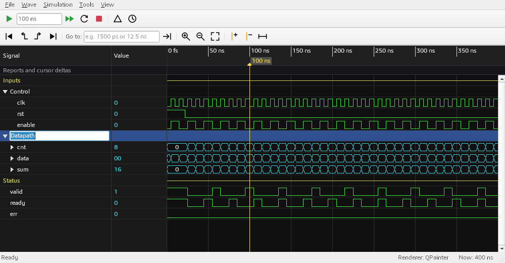
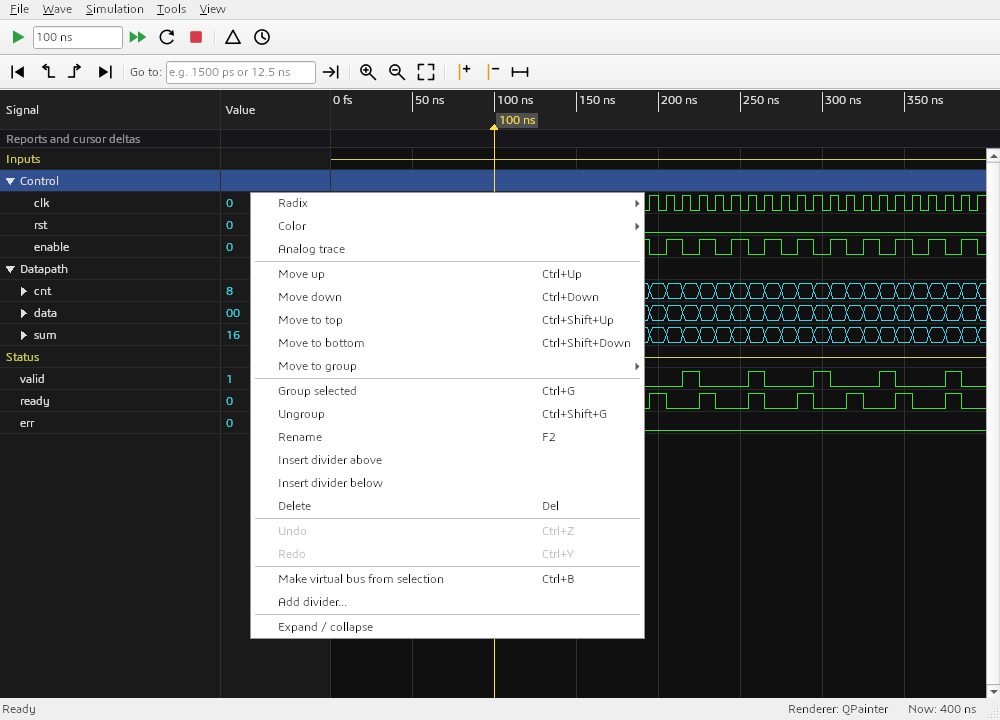

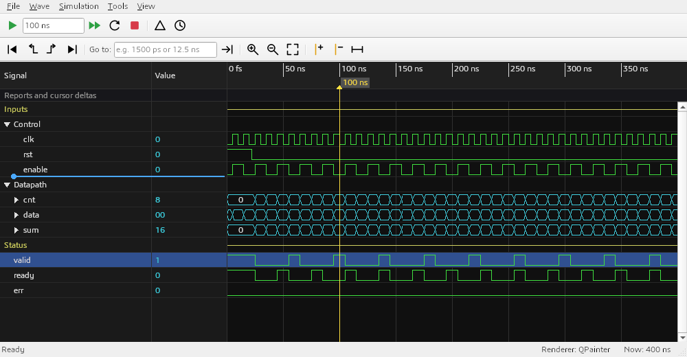

Moving a row never redraws it: the waveform tiles of a row are cached under the row's identity, not its position. The order, the
group names, the divider texts and the collapsed state are kept by **File > Save wave format** (an `add wave` script, with `-group A/B`
for nested groups; see [display-format.md](display-format.md)), by **Save wave layout**, and across **Restart**.

#### Scroll bars, Follow and analog settings

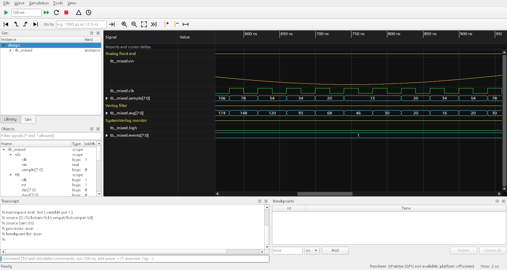

- **Horizontal bar (time).** Its range is the whole run the window knows (0 to the end of the data, growing while a simulation runs).
  The thumb is the visible window and fills the bar when everything is shown. Drag it, click beside it for a page, use the arrows
  (a tenth of a window) or the wheel over it. The bar follows every other way of moving the view (shift or sideways wheel, middle
  drag, Ctrl+Left/Right, zoom, Go to).
- **Vertical bar (rows).** It scrolls the name column, the value column and the waveforms together (they are one window with one
  scroll offset), also with 10 000 rows. The plain mouse wheel scrolls it too.
- **Follow** (toolbar button with the `>>|` icon, tooltip "Follow simulation (stay at end)", **View > Follow simulation**, Ctrl+Shift+F):
  while on, the right edge of the view stays at the end of the recorded data as the run grows, with the zoom width you have, like
  `tail -f`. Zoom first (for example `+`), then switch it on, and run: the window slides along with `run` commands.
  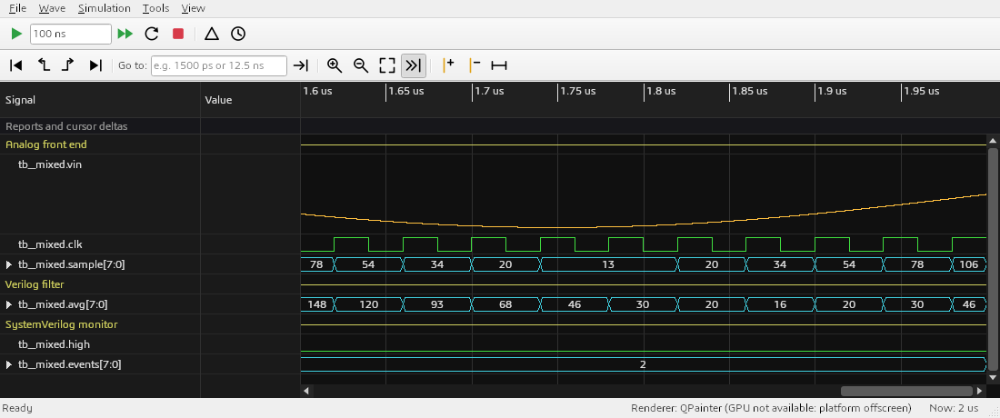
  Anything that moves the window by hand switches it off and the button pops out: the horizontal bar, shift/sideways wheel, middle
  drag, Ctrl+Left/Right, Home/End, Go to, a cursor jump that has to scroll, Zoom full (`F`). Zooming (wheel, `+`, `-`) keeps it on and
  keeps the end at the right edge, instead of the point under the pointer. If you never zoomed, the view still fits the whole run
  (which ends at the end of the data as well) until your first zoom. The state is saved in the settings (`wave/follow`). With Follow
  off nothing moves when data arrives, except that a view that is already showing the end keeps showing it.
- **Analog Settings...** (context menu of an analog row, and the Wave menu): a modal dialog for the selected analog rows. **Auto range**
  (default) draws between the lowest and highest value of the whole signal, the same for every tile and every zoom level (it grows
  while a live run produces new extremes, and the row is redrawn). **Manual range** takes **Min** and **Max** (`-1.5`, `2e-3` ...),
  preloaded with the range the row is drawn with now; OK stays disabled with a message while Min is not less than Max or a field is
  not a number. Values outside the range are drawn on the top or bottom edge of the row. One undo step (`Ctrl+Z`). The range is saved
  in layouts and in `.do` files as `-min`/`-max` (see [display-format.md](display-format.md)).

| Auto range (0 to 3.3 V of the data) | Manual range 1 to 2.5, the sine is clipped at both edges |
|---|---|
| 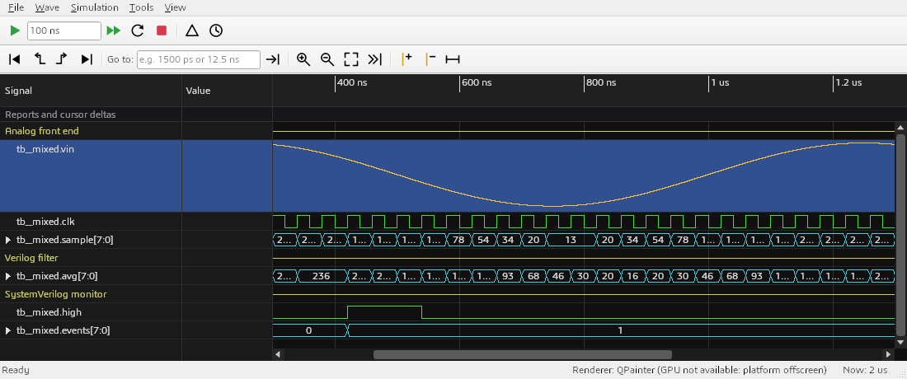 |  |

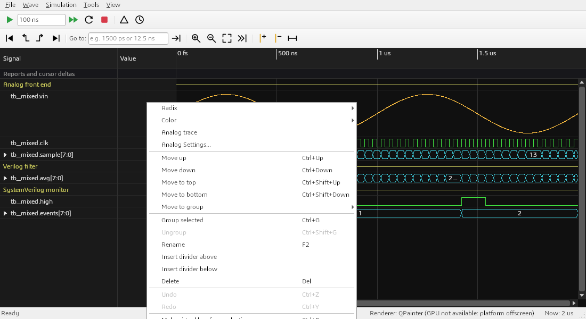
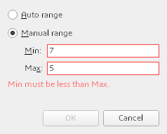

For screenshots, `--wave-op "zoom 5"`, `"scroll-time 0.35"` (left edge at a fraction of the run), `"follow on|off"` and
`"analog-range NAME auto"` / `"analog-range NAME MIN MAX"` work like the other `--wave-op` commands.

### The toolbars

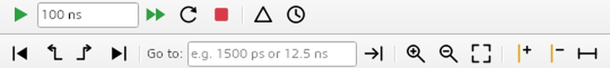

Top row, left to right: **Run** with the run length next to it (`100 ns`; Enter in the box also runs), **Run -all**, **Restart**
(back to time zero, wave rows kept, the startup script not run again), **Stop**, **Step delta**, **Step time**.
Bottom row: go to start, previous and next transition, go to end, **Go to**, zoom in, zoom out, zoom fit, add cursor, remove cursor, add divider.
Hover a button for its tooltip. The menus mirror the actions:

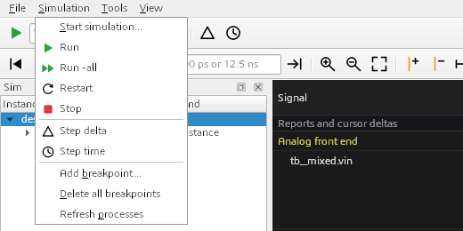

### The transcript

Type any Tcl or simulator command in the line at the bottom of the window. The commands below were sent to the running
`mixed_language` session with `--send` (the transcript text is exactly what the program saved):

```
% run -json 500 ns
# Paused at 500 ns, delta 2
% examine /events
"00000001"
% force /rst '1'
% run -json 100 ns
# Paused at 600 ns, delta 1
% noforce /rst
% run -json 100 ns
# Paused at 700 ns, delta 2
% examine /avg
"00101001"
```

(`run` and `step` are sent with `-json` inserted: the GUI parses the machine-readable reply. You type plain `run 100 ns`.)
A VHDL `std_logic` force needs the quotes, `'1'`; an unquoted `1` is an error from the kernel. The forced reset is visible in the `rst` row:

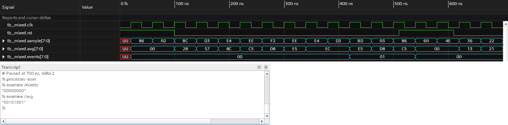

Note that `examine` cannot print `real` signals yet; look at them in the wave window.

### Library, Sim and Objects docks

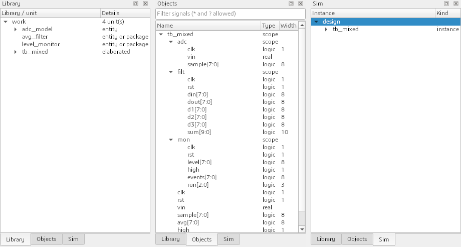

- **Library** lists the compiled units of `work` (and of every library folder, see [section 5](#5-vendor-libraries)): entity,
  elaborated design.
- **Sim** is the instance tree of the elaborated design (`design` > `tb_mixed`, expandable).
- **Objects** lists signals with their type and width; the filter box accepts `*` and `?`. Rows are added to the wave window with `add wave`. The left column is
  narrow by default, so long names are cut: drag the splitter to widen it.

### Processes, Source and Breakpoints, stepping

Start the design without a startup script, add some rows, set a time breakpoint, run, then step two cycles:

```sh
lvdsim-gui work.tb_mixed
```

and in the transcript (or with `--send` from a script):

```
% add wave /clk /sample /avg /events
% breakpoint add 500 ns
1
% run 2 us
# Breakpoint 1 hit at 500 ns (now 500 ns, delta 2)
% step -delta
# Paused at 510 ns, delta 0
% step -time
# Paused at 510 ns, delta 1
```

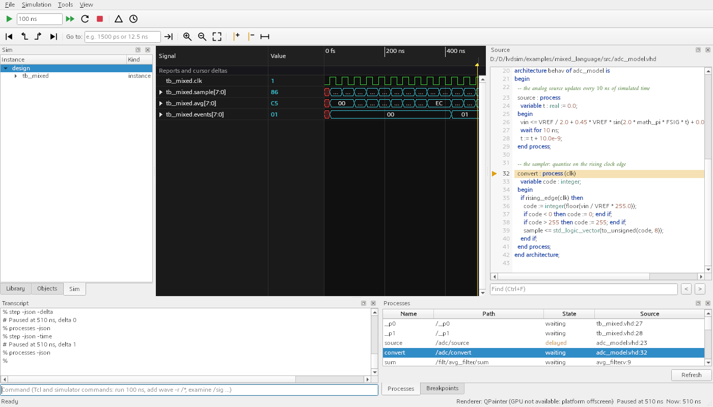

- **Processes** lists every process with its path, state and source file and line. Double-click one: **Source** opens the file with the
  process line highlighted (with the Source dock showing `(no file)` until you select a process; on the command line use
  `--process convert`). **Step delta** runs one simulation cycle, **Step time** finishes the current time step. Both are simulation
  cycles, not source lines. The status bar shows `Paused at 510 ns`.
- **Breakpoints** (tabbed with Processes) handles time breakpoints: one shot, absolute time. Type a time and a unit and press Add, or use
  `breakpoint add 500 ns`. A breakpoint that was hit is removed, so the list below shows two that are still pending:

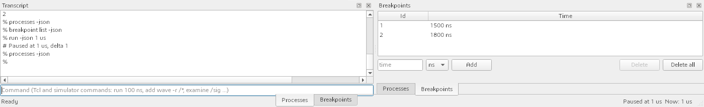

Source (line) breakpoints and `when` conditions are not implemented ([command-compat.md](command-compat.md)).

### The GPU renderer switch

All wave rows are drawn through one renderer interface. There are two renderers: a GPU renderer (a QRhi tile atlas, Direct3D 11 on
Windows) and a QPainter tile renderer that works everywhere. **The GPU renderer is the default.** If the GPU cannot be used (remote
desktop, virtual machine, offscreen platform, a driver error) the window falls back to QPainter by itself, prints one line about it
in the transcript the first time, and the status bar at the bottom shows what is drawing: `Renderer: GPU`, or
`Renderer: QPainter (GPU not available: reason)`.

**View > Waveform renderer** has three exclusive entries:

- **Automatic** (the default): ask for the GPU, fall back to QPainter when it fails.
- **QPainter only**: never use the GPU.
- **GPU only**: ask for the GPU too; a failure is still reported and the window still falls back, so you never get a blank wave pane.

The choice is stored in the settings file (key `render/backend`: `auto`, `cpu` or `gpu`). The environment variable `LVDSIM_RENDERER`
(`auto`, `cpu`, `qpainter`, `gpu`) overrides the stored choice for one run:

```bat
set LVDSIM_RENDERER=cpu
lvdsim-gui -do sim.do work.tb_mixed
```

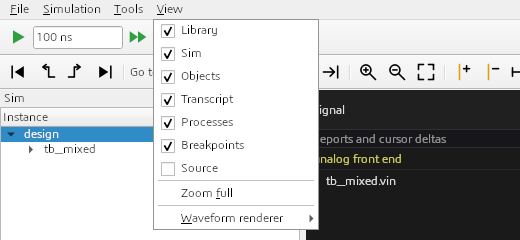

The screenshot option `--open-menu` opens only the top-level menu, so the submenu itself is not shown; the three entries are the ones listed above.

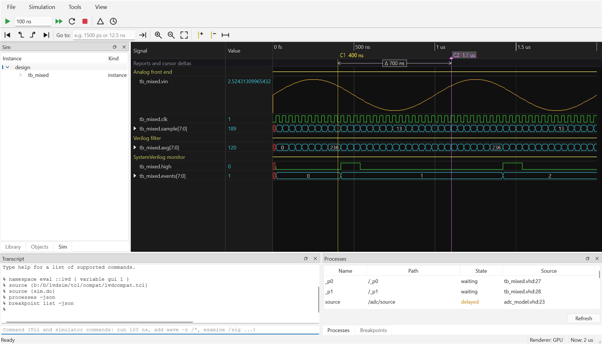

The GPU shot was taken in a real window with the default policy on a display with 150 percent scaling and reduced to 1400x800 here;
the offscreen screenshots elsewhere in this tutorial always use QPainter (they show `Renderer: QPainter (GPU not available: ...)`).
Tiles are rasterised at logical resolution, so on high-DPI screens GPU output is slightly softer than QPainter.

Why the GPU is the default: on a 3840x2160 wave window with many analog rows, `bench_paint` measures (CPU = QPainter, GPU):
a cold full-zoom frame 35.7 / 27.4 ms, a warm one 4.9 / 1.7 ms, a zoom step on average 10.4 / 11.5 ms, a pan step 5.9 / 1.8 ms. Panning
is 3 to 5 times faster, cold frames are about equal.

### Saving the wave format

**File > Save wave format (.do)...** writes the wave window as `add wave` commands; **Load wave format (.do)...** adds them back to
a running simulation (after a simulation has started, so the signals are known). **Save/Load wave layout** keep the lvdsim-specific
layout (virtual buses, collapsed groups). After adding a hex row to the example, the saved file reads:

```tcl
# lvdsim wave layout: familiar add wave commands (virtual bus, group collapse and show-bits are lvdsim extensions)
add wave -divider {Analog front end}
add wave -format analog-interpolated -min 0 -max 3.2999999999999998 -height 88 /tb_mixed/vin
add wave /tb_mixed/clk
add wave -radix unsigned {/tb_mixed/sample[7:0]}
...
add wave -radix hex -label sample_hex {/tb_mixed/sample[7:0]}
```

Loading it into a fresh session of the same design (the transcript says `Loaded 10 row(s) from ...mixed_wave.do`) restores all rows:

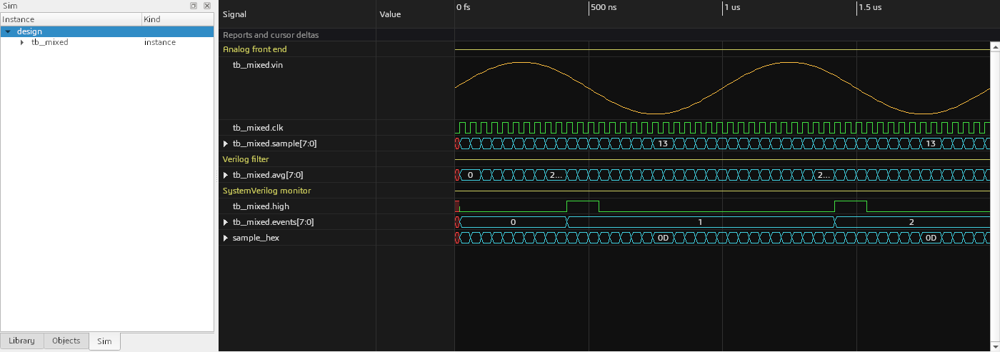

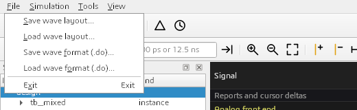

## 4. Reports in the transcript and the event band

`examples/reports` prints a report of every severity at different times. NVC prints each as `** Note: 100ns+0: text`; lvdsim turns
the time stamp into a link. Compile and run it:

```sh
cd examples/reports
vlib work
vcom -2008 -work work src/tb_reports.vhd
lvdsim-gui -do "add wave -r /*; run 3 us" work.tb_reports
```

(`src/mon.v` is a Verilog `$display` module that stays plain text because Verilog prints no time stamp.) The transcript after the
run:

```
** Note: 100ns+0: reset released
** Warning: 250ns+0: fifo almost full
** Note: 300ns+0: burst one
** Note: 300ns+0: burst two
** Warning: 300ns+0: burst three
** Error: 500ns+0: checksum mismatch
** Note: 1500ns+0: late note at one and a half microseconds
** Failure: 2us+0: fatal condition, stopping
```

(each followed by a `Process :tb_reports:_p2 at src/tb_reports.vhd:21` line). The time stamps are underlined in the colour of
the severity: note blue, warning amber, error red, failure magenta. Click one and cursor 1 jumps to that time in the wave window (the
view scrolls only if the time is outside it). Hover shows the exact time in femtoseconds.

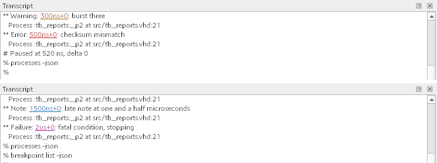

Each report also puts a coloured arrow in the band under the ruler. Arrows that fall into the same pixel column merge into one (the
most severe colour wins; the tooltip has the count), so the cost does not grow with the number of reports. Click an arrow to move cursor 1
to its first event.

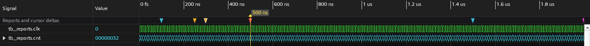

Both screenshots come from sessions that had cursor 1 placed at 500 ns with `--cursor 500000000`, which is what clicking the `500ns+0` link does.
Details: [gui-reports.md](gui-reports.md).

## 5. Vendor libraries

lvdsim never ships Xilinx or Altera sources. It compiles the simulation libraries from **your own** Vivado or Quartus installation.
Two ways: the scripts `scripts/libs/compile_libs.sh|.bat`, and the dialog in the GUI that runs them. Both are described in
[libraries.md](libraries.md); tested with Vivado 2022.2 and Quartus Pro 24.2 only.

### Tools > Compile libraries...

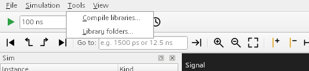

Pick the vendor. The dialog proposes the installations it finds, and the libraries the scripts build by default:

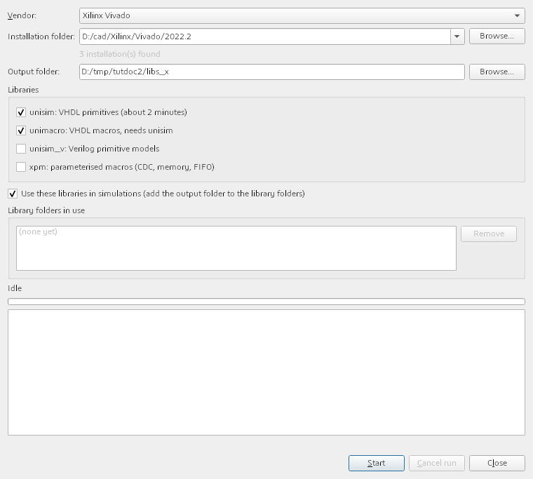

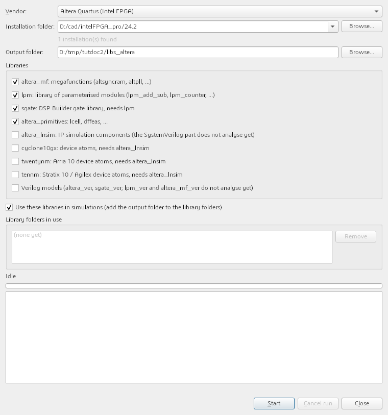

For the Xilinx default set (unisim, unimacro) expect about two minutes; the Altera default set takes a few seconds. Press **Start**. The
window never blocks: the log shows the script output as it comes, the progress bar counts libraries, **Cancel run** stops the whole
process tree. This is the Altera run on this machine:

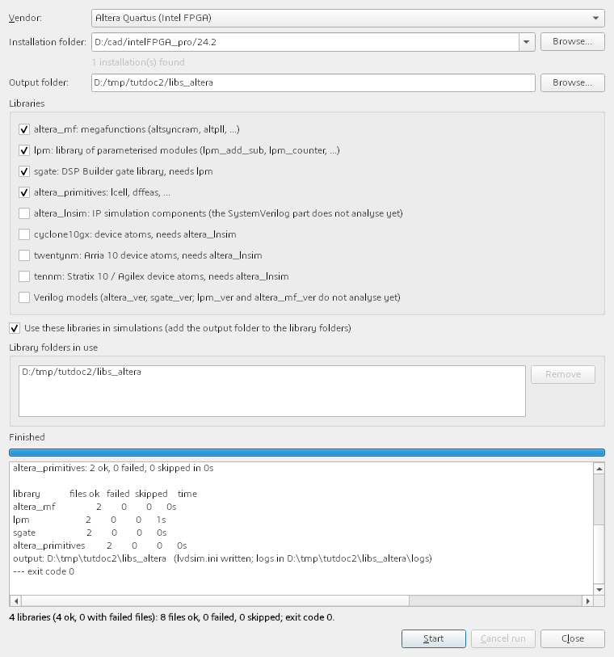

With **Use these libraries in simulations** ticked, the output folder joins the library folders: every simulation started from the
window gets `-L altera_mf -L lpm ...` for the libraries found there, and the Library dock lists them. You still analyse your own
design with `vcom -L ...` as usual. The script also writes a `lvdsim.ini` in the output folder mapping the library names.

### Using the libraries: examples

**altera_mf** (the Altera example; no Quartus files in the repository). Compile the libraries once into a folder, then:

```sh
cd examples/altera_mf
LVDSIM_INI=/d/libs/altera/lvdsim.ini sh ./run.sh --batch        # your output folder; without --batch the GUI opens
```

```
** Note: 26ns+0: sum=61 cnt=3 ram=90
** Note: 26ns+0: PASS
```

In the GUI (`sh ./run.sh` with no argument does this, with `sim.do`; by hand, `lvdsim.ini` found through `LVDSIM_INI`, the libraries given with `-L`):

```sh
LVDSIM_INI=/d/libs/altera/lvdsim.ini lvdsim-gui -L altera_mf -L lpm -do "add wave -r /*; run -all" work.alt_demo
```

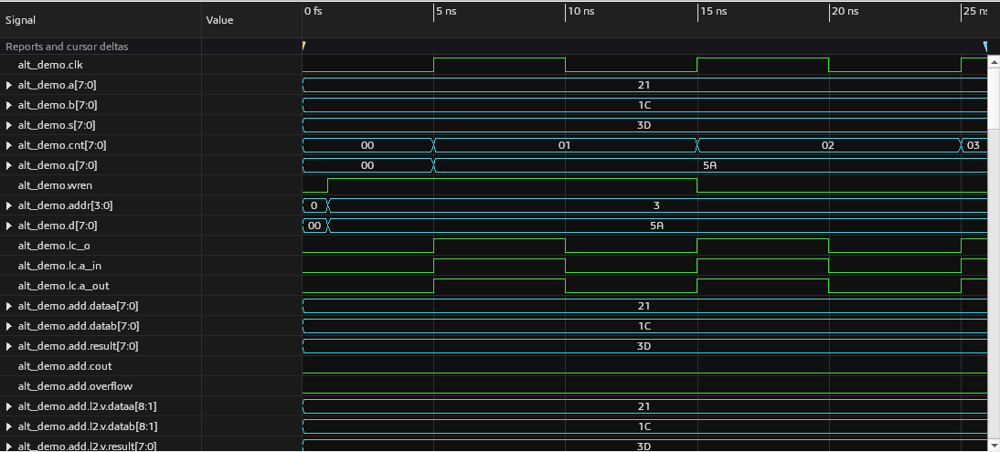

The Quartus Pro `altsyncram` model supports Arria 10 and Cyclone 10 GX only, hence `intended_device_family => "Arria 10"` in the example.

**vivado_unisim** (`examples/vivado_unisim`) and **xpm_unisim** need the Xilinx libraries: build `unisim`, `unimacro`, `unisim_v` and `xpm`
with the dialog or the script, then follow the README of each folder. `stress_10k` (about 10 000 signals, 118 lanes of VHDL, Verilog,
SystemVerilog and unisim cells) is the large run for the kernel and the viewer. The step-by-step commands and expected results are in
[examples/README.md](../examples/README.md) and [examples/xpm_unisim/README.md](../examples/xpm_unisim/README.md). Those two Xilinx
flows were not repeated for this tutorial; their results come from the earlier test runs recorded there and in [libraries.md](libraries.md).

## 6. The command line and batch flow

Without a window the same design runs as a batch job: the simulation is driven by a script and the result is printed or saved.
This is the flow for regressions and for machines without a display. Compile as in [section 2.1](#21-prepare-the-design-once), then
simulate 2 us without a GUI and print two signals:

```sh
cd examples/mixed_language
vsim -c -do "run 2 us; puts [list events [examine /events] avg [examine /avg]]; quit" -lvdwave mixed.fst work.tb_mixed
```

```
events {"00000010"} avg {"00101110"}
```

`-lvdwave mixed.fst` saves the waveform (`mixed.fst`, about 3 KB) as FST, a file you can keep, compare or open in other tools. The
same flow is in `run.sh --batch` and `run.bat --batch` of the example (without `--batch` they open the GUI instead). A batch run has no window to follow, so a file is the way to look at its result
afterwards. Signal paths start at the testbench instance: write `/events`, not `/tb_mixed/events`.

A `.do` file is a plain Tcl script run by `-do`. `vsim -c -do sim.do work.tb_mixed` runs the one from section 2: the `add wave` lines are
accepted and have no effect without a window, `run 2 us` simulates and the shell ends when the script does. A free-running design such as
this one (its clock never stops) needs a time on `run`; `run -all` is for designs that end by themselves.

Without `-do` you get the interactive Tcl shell of the kernel; type `help` for its commands and `quit` to leave:

```
$ vsim -c work.tb_mixed

nvc 1.24-devel (754af76cc) (Using LLVM 23.1.5)
...
Type help for a list of supported commands.

%
```

## 7. Common problems

1. **Another simulator's `vcom`, `vlog` or `vsim` runs instead.** Check `where vcom` (or `which vcom`). The lvdsim folder must come first
   on `PATH`; with the package, the programs next to `lvdsim-gui.exe` always know their own nvc.
2. **An error about a missing `work` library.** Run `vlib work` first, in the folder where you compile. Libraries are directories; names map through
   `lvdsim.ini` (`[Library]` section) in the current folder, or the file named by `LVDSIM_INI`. The file name is `lvdsim.ini`; other names
   are ignored.
3. **Compiled library does not load after rebuilding nvc** (`serialised format digest ... should be reanalysed`): run the library script or
   the dialog again, and re-analyse your design. The opposite case gives no error: Verilog units analysed by an older `nvc` still load and
   run, but keep truncating `$time` instead of rounding it, because the scaling is built in when the source is parsed (the serialised
   format digest is unchanged). After updating `nvc`, recompile Verilog libraries such as the Verilog `unisim` with `scripts/libs/compile_libs`
   (or Tools > Compile libraries) to get the rounding.
4. **The wave pane is squeezed to nothing**, or the window is small. The window layout is saved in the user settings and restored.
   Start with a fresh settings file: `lvdsim-gui --settings fresh.ini ...` (the same option keeps a screenshot setup separate from your
   own layout).
5. **Source says `(no file)`.** Select a process in the Processes dock (double-click). Rows of `real` signals need an analog format
   in `add wave`.
6. **Build tree: nvc not found, or a crash on start.** Set `LVDSIM_NVC`, `LVDSIM_NVC_LIBDIR`, `LVDSIM_NVC_DLLDIR` as in section 1 and put
   `C:\msys64\mingw64\bin` before Qt's MinGW directory.
7. **The wave pane is blank, flickers, or the window is slow over remote desktop or in a virtual machine (a GPU problem).** The GPU renderer
   normally falls back to QPainter by itself, and the status bar says `Renderer: QPainter (GPU not available: ...)`. If the GPU
   starts but draws wrongly, force QPainter: View > Waveform renderer > QPainter only, or start with `set LVDSIM_RENDERER=cpu`
   (`export LVDSIM_RENDERER=cpu` on Linux). Report the reason text from the status bar or the transcript.
8. **Screenshots without a screen** (this is how the images here were made):

```sh
export QT_QPA_PLATFORM=offscreen
export QT_QPA_FONTDIR='C:\Windows\Fonts'
cd examples/mixed_language
lvdsim-gui --settings fresh.ini -do sim.do work.tb_mixed --cursor 400000000 --cursor 1100000000 --screenshot out.png
```

Other options: `--send "cmd"` (repeatable, runs once the kernel is idle), `--process NAME`, `--transcript out.txt`, `--size W H`,
`--hide-dock NAME` and `--show-dock NAME` (library, structure, objects, transcript, processes, breakpoints, source),
`--open-menu View`, `--save-format f.do`, `--load-format f.do`, `--show-dialog compile-libs [--dialog-vendor altera]
[--dialog-install DIR] [--dialog-out DIR] [--dialog-run]`. For the GPU renderer use the real platform: `QT_QPA_PLATFORM=windows`, the default policy (no
`LVDSIM_RENDERER`) and no `QT_QPA_FONTDIR`; a window opens for a moment and `--screenshot` waits for the first GPU frame.

## 8. Where to go next

- [command-compat.md](command-compat.md): which classic commands and options exist, and their status.
- [libraries.md](libraries.md): Vivado and Quartus libraries, measured times, known failures.
- [packaging.md](packaging.md): zip, installer, Linux tarball, what the installer changes.
- [verilog-coverage.md](verilog-coverage.md): what of the Xilinx Verilog models simulates.
- [protocol.md](protocol.md) (the live stream and the JSON replies), [gui-reports.md](gui-reports.md), [kernel-tests.md](kernel-tests.md).
- [examples/README.md](../examples/README.md) for all examples.
