# lvdsim tutorial

This walk-through takes a new user from an unpacked download to a design that is **simulating in front of you**: you compile
once, start the window, add signals and press Run, and the waveform draws itself while the simulation advances. There is no
"simulate first, write a dump file, open the waveform afterwards" step. It then covers a tour of the window, the HDL report links, the
Xilinx and Altera library helpers and, later, the command-line (batch) flow. Every command below was run on Windows 11 while writing
this page, and the output you see is what the program printed. The screenshots are real captures of `lvdsim-gui`.


> **Live waveform.** `lvdsim-gui` starts the simulator as a child process and reads the waveform from a live stream while the
> simulation runs. Signals appear and extend on screen as simulation time advances, `run`, `step` and breakpoints act on that same
> session, and you can add rows at any time. "Live" means the *viewer follows the kernel*; it does **not** mean the simulation is
> paced to wall-clock time. The kernel runs as fast as it can. Section 2 shows the same window captured while a run is in
> progress. FST files are only for saving a trace ([section 6](#6-the-command-line-and-batch-flow)).

Contents: [1 Install](#1-install) - [2 Run a design in the GUI, live](#2-run-a-design-in-the-gui-live) -
[3 Tour of the window](#3-tour-of-the-window) -
[4 Reports in the transcript and the event band](#4-reports-in-the-transcript-and-the-event-band) -
[5 Vendor libraries](#5-vendor-libraries) - [6 The command line and batch flow](#6-the-command-line-and-batch-flow) -
[7 Common problems](#7-common-problems) - [8 Where to go next](#8-where-to-go-next)

The examples are in the source tree (`examples/`), not in the Windows package. Clone or download the repository, even if you
use the packaged programs.

## 1. Install

### From the zip

`lvdsim-0.1.5-win64-portable.zip` is a self-contained folder (about 215 MB unpacked, most of it LLVM for the NVC JIT). Unpack it anywhere:

```powershell
Expand-Archive lvdsim-0.1.5-win64-portable.zip -DestinationPath C:\tools
```

Nothing is installed and nothing is written to the registry (see [Portable use](#portable-use)). The programs find `nvc`, its libraries
and the Tcl command package relative to their own location, so no environment variables are needed. To type `vcom` or `vsim` in a
terminal, put the folder on `PATH` for that terminal only:

```bat
set PATH=C:\tools\lvdsim-0.1.5-win64-portable;%PATH%
```

Put the folder **before** the rest of `PATH` (see [problem 1](#7-common-problems)). Do not put `nvcin` on `PATH`: nvc uses MSYS2
runtime DLLs that clash with the Qt runtime of the other programs.

### From the installer

`lvdsim-0.1.5-win64-setup.exe` installs the same folder, per user by default (`%LOCALAPPDATA%\Programs\lvdsim`, no administrator
rights) or for all users if you choose that in the first dialog. The **Select Additional Tasks** page has two check boxes:

- **Add lvdsim to the PATH (vlib, vmap, vcom, vlog, vsim and lvdsim-cli)**: ticked by default. It appends the install folder (never
  `nvc\bin`) to the user `PATH`, or to the system `PATH` for an all-users install, once; reinstalling does not add it twice and
  uninstalling removes only that entry. Untick it if you prefer to set `PATH` per terminal as above. Terminals that were already open
  keep the old `PATH`: open a new one after the installer finishes.
- **Create a desktop icon**: unticked by default.

(No screenshot of the installer pages is shown: it was tested silently, per user, on the development machine, never as an all-users install; the
behaviour is described in [packaging.md](packaging.md).)

### Portable use

The zip (and the Linux `-portable.tar.gz`) contains a file `portable.txt` next to `lvdsim-gui`. While it is there the program keeps
everything it saves inside its own folder:

- `data\lvdsim-gui.ini` holds the window layout and options (nothing goes to the registry or to `~/.config`);
- `data\libraries` is the default output folder of **Tools > Compile libraries**.

So you can unzip anywhere, carry the folder on a USB stick, and your settings and compiled libraries travel with it. Do not run it from a
read-only location (a DVD, a locked share): the window then falls back to the normal per-user settings and says so in the transcript.
Temporary files still use the system temp folder. Delete `portable.txt` to switch the mode off, or set `LVDSIM_PORTABLE=1` to switch it on
for a copy that has no marker. `lvdsim-gui --settings FILE` always wins. The installer's copy has no `portable.txt` and uses the normal
per-user settings.

### From the Linux installer

`lvdsim-0.1.5-linux-x86_64.run` is a shell script with the program bundle appended (about 70 MB, Qt and nvc included; it needs glibc 2.38
or newer, for example Ubuntu 24.04 or Debian 13, and `xz` to unpack). Run it as your normal user:

```sh
sh lvdsim-0.1.5-linux-x86_64.run
```

It prints the licence summary (GPL-3.0-or-later), checks its checksum and installs into `~/.local/opt/lvdsim`. It creates symlinks
for `lvdsim-gui`, `lvdsim-cli`, `vlib`, `vmap`, `vcom`, `vlog` and `vsim` in `~/.local/bin`, a menu entry `lvdsim` and its icon under
`~/.local/share`. Your `PATH` and shell startup files are **not** changed; if `~/.local/bin` is not on your `PATH` the installer says so
and prints the line to add:

```sh
export PATH="$HOME/.local/bin:$PATH"
```

(or install with `--add-path`, which appends a clearly marked block to `~/.profile` and `~/.bashrc`). Other options: `--prefix DIR`,
`--yes`, `--no-symlinks`, `--no-desktop`, `--extract DIR` (unpack without installing), `--check`, `--list`, `--license`.
To remove lvdsim: `sh lvdsim-0.1.5-linux-x86_64.run --uninstall` (add `--prefix DIR` if you used one); it removes exactly what the
installer created. Without installing you can also run `sh lvdsim-0.1.5-linux-x86_64.run --extract ~/lvdsim` and then `~/lvdsim/AppRun`
(the GUI) or `~/lvdsim/AppRun --run vsim ...`. On a machine without a desktop session use `QT_QPA_PLATFORM=offscreen lvdsim-gui ...`.

### From source

You need Qt 6.11 (MinGW kit), CMake, Ninja and the NVC fork built with MSYS2 (`kernel/build/build-nvc-msys2.sh`). From a Git Bash
in the repository root:

```sh
export PATH="/c/Qt/Tools/mingw1310_64/bin:/c/Qt/Tools/Ninja:/c/Program Files/CMake/bin:$PATH"
cmake --preset mingw-debug
cmake --build --preset mingw-debug
ctest --preset mingw-debug
```

Everything lands in `build/mingw-debug/bin` (`lvdsim-gui`, `lvdsim-cli` and its copies `vlib vmap vcom vlog vsim`). A build-tree run has
to be told where nvc is. Set this up once per shell; the rest of this tutorial assumes it whenever it says "build tree":

```sh
B=$PWD/build/mingw-debug/bin
K=$PWD/kernel/nvc/build
export PATH="$B:/c/msys64/mingw64/bin:/c/Qt/6.11.1/mingw_64/bin:/c/Qt/Tools/mingw1310_64/bin:$PATH"
export LVDSIM_NVC=$K/bin/nvc.exe
export LVDSIM_NVC_LIBDIR=$K/lib
export LVDSIM_NVC_DLLDIR=C:/msys64/mingw64/bin
```

The MSYS2 directory must come before Qt's MinGW directory. In a Windows command prompt the equivalent `set` lines are in
[examples/README.md](../examples/README.md), section 1.

## 2. Run a design in the GUI, live

`examples/mixed_language` is a small mixed-language design with no third-party code: a VHDL analog source (a sine on a `real`
signal) and 8-bit ADC, a Verilog moving-average filter, a SystemVerilog threshold monitor, and a VHDL testbench. The example also puts
real-valued (analog-style) signals next to digital logic; there is no analog solver.

**PATH for this section:** either the package folder (programs find nvc themselves) or the build-tree setup of section 1.

### 2.1 Prepare the design (once)

The window simulates compiled libraries, and it does not compile your sources when it starts. Compile from a terminal first;
Verilog and SystemVerilog before VHDL, so that VHDL can instantiate them:

```sh
cd examples/mixed_language
vlib work
vlog -work work src/avg_filter.v
vlog -sv -work work src/level_monitor.sv
vcom -2008 -work work src/adc_model.vhd src/tb_mixed.vhd
```

`vlib` prints `Creating library 'work'.` (`Library 'work' already exists.` if you run it again); the compilers print nothing when
everything is fine. This is all the preparation there is: you do **not** run a simulation at this point. (Once a simulation is
running, `vlib`, `vmap`, `vcom` and `vlog` can also be typed in the transcript line of the window; they run the same tools and the
Library dock refreshes. The window itself cannot start without a compiled design.)

The example folder has `run.sh` and `run.bat` that do this compile step and then start the window of section 2.2 with `sim.do` in one go
(`examples/mixed_language/run.sh`, or `run.bat`); closing the window ends the run. `run.sh --batch` is the batch flow of
[section 6](#6-the-command-line-and-batch-flow). The commands are spelled out here so that you see each step.

### 2.2 Start the window

```sh
lvdsim-gui work.tb_mixed
```

`vsim work.tb_mixed` without `-c` does the same: it starts `lvdsim-gui`. The window opens at time 0 with an empty wave area. The
simulator is already running as a child process (the transcript shows its banner), waiting for your commands. Signal paths start at
the testbench instance: write `/clk`, not `/tb_mixed/clk`.

### 2.3 Add waves, run, and watch the waveform grow

Type these lines in the transcript (the line at the bottom of the window), one after the other:

```
% add wave /clk /sample /avg /events
% run 200 ns
% run 400 ns
% run 1400 ns
```

Each `run` advances the same simulation from where it stopped, and every row grows to the right as the time moves on. Nothing is
reloaded or refreshed, and no file is opened. The same rows can come from a script: `lvdsim-gui -do sim.do work.tb_mixed`, where
`sim.do` is a plain script that adds the rows and runs 2 us:

```tcl
add wave -divider {Analog front end}
add wave -format analog-interpolated -height 80 -min 0 -max 3.3 /vin
add wave /clk
add wave -radix unsigned /sample
...
run 2 us
```

The three captures below are **one window of one session**. A script ran `run 200 ns`, waited six seconds, ran `run 400 ns`, waited
six seconds and ran the rest, and the window was captured (the window only, with the transcript cropped out) during each wait. Look at
the ruler and at the `Now:` field of the status bar: 200 ns, 600 ns, then 2 us.


(The status bar says `Running...` in all three because the script was still executing between the runs.) With `-do sim.do` or `run -all`
the same thing happens without pauses: the waveform is drawn as the kernel produces it.

### 2.4 A long run: the waveform follows the kernel

The captures above are short runs. For a longer one, the `stress_10k` example was started with 30 lanes
(`-g N_LANES=30`, a startup script ending in `run 20 ms`) in a real window on Windows (the release build, QPainter renderer) and the
window was captured while the run was still going on, a few seconds apart. `Running...` and the `Now:` field of the status bar
come from the program, the ruler rescales as the stream grows:


All three are the same window and the same session; nothing was reloaded in between. The run had not finished in any of them.

### 2.5 What "live" means, and what it does not

- **How it works.** The window starts `nvc` as a child process and asks it to write its waveform as a live stream (`--format=live`)
  into a temporary file. The kernel writes the design hierarchy first and then every value change, appending, and flushes it when a
  `run` ends and whenever its output buffer fills during a long run. The window reads what was appended about every 60 ms and adds it to
  an in-memory store that the wave pane draws from. The whole design is streamed, so a row added later with `add wave` shows its full
  history from time 0. Details: [protocol.md](protocol.md).
- **What you get.** Run, run -all, step delta, step time and time breakpoints act on the live session ([section 3](#processes-source-and-breakpoints-stepping)).
  After a pause you can add or change rows, move cursors, zoom, and continue. **Break** ends a run that is still going (see
  [Break and Stop](#break-and-stop)); Stop ends the simulation; the waveform stays on screen.
- **What it does not mean.** The simulation is not slowed to real time, and it is not faster than the kernel: a big design simulates
  as slowly as before (the 10 000 signal example takes about 90 s for 20 ms of simulated time). The viewer follows the kernel; during
  a long run the new data arrives in chunks as the stream is flushed.
- **Saving a trace.** FST is only a file format for saving: `-lvdwave file.fst` in batch mode ([section 6](#6-the-command-line-and-batch-flow)).
  The GUI never reads FST while it is being written.

## 3. Tour of the window

The layout follows the familiar simulator arrangement: Library, Sim (design structure) and Objects docks on the left, the Wave window
in the middle, Source and List on the right, Transcript, Processes and Breakpoints along the bottom. Every dock can be closed, floated and
brought back with the **View** menu.

### The wave window


- **Analog row**: `add wave -format analog-interpolated -height 80 -min 0 -max 3.3 /vin` draws a `real` signal as a trace
  (`analog-step` gives a staircase). There is no `-analog` option.
- **Buses** show their value in the bar when it fits; click the triangle to expand a bus into its bits. Undefined values (`U`, `X`) are
  drawn red.
- **Radix**: `add wave -radix hexadecimal|binary|signed|unsigned|ascii ...` (shown above as `sample_hex`, `events_bin`,
  `avg_signed`). `-label` renames a row, `-divider` adds a yellow separator line.
- **Cursors** (toolbar buttons `|+` and `|-`, shift-click in the wave, or `--cursor` on the command line): the value column shows each signal at cursor 1.
  With two cursors, the band between the ruler and the first row carries the labels `C1 400 ns`, `C2 1.1 us` and the delta
  `700 ns`. The same band holds the report arrows of [section 4](#4-reports-in-the-transcript-and-the-event-band), so labels never cover a wave.
- Zoom with the magnifier buttons (or `+`, `-`, `F`), **Go to:** accepts `1500 ps` or `12.5 ns`.

#### Arranging signals: groups, dividers, rename, move

Select rows in the name column (click, Ctrl-click, Shift-click; the Up and Down arrows walk the selection) and arrange them.
Everything is also in the **Wave** menu and in the context menu (right click on a row).

| Keys | What it does |
|---|---|
| Ctrl+Up / Ctrl+Down | move the selected rows up or down among their siblings (a group moves with its rows) |
| Ctrl+Shift+Up / Ctrl+Shift+Down | move to the top or the bottom of their group |
| Ctrl+G / Ctrl+Shift+G | wrap the selection in a new group (`Group`, `Group 2`, ...) / replace the selected groups by their rows |
| F2 | rename the group, divider, bus or signal label in place (Enter applies, Escape cancels; a group needs a name, a divider may be empty) |
| Ctrl+Z / Ctrl+Y (or Ctrl+Shift+Z) | undo / redo these edits, 100 steps |
| Del | remove the selected rows (a group takes its rows with it) |

The context menu adds **Move to group** (any existing group, *Top level*, or *New group...*), **Insert divider above / below**
(the new divider opens its name editor) and **Ungroup**. You can also **drag** rows by the name column: a blue line shows where
they land, a highlighted group row means "into this group", the list scrolls when you hold the pointer near the top or bottom edge,
Escape cancels, and a group cannot be dropped into itself. Dropping outside the name column does nothing.


Renaming a group opens an editor over its row, and the context menu holds the arranging commands:


Moving a row never redraws it: the waveform tiles of a row are cached under the row's identity, not its position. The order, the
group names, the divider texts and the collapsed state are kept by **File > Save wave format** (an `add wave` script, with `-group A/B`
for nested groups; see [display-format.md](display-format.md)), by **Save wave layout**, and across **Restart**.

#### Scroll bars, Follow and analog settings


- **Horizontal bar (time).** Its range is the whole run the window knows (0 to the end of the data, growing while a simulation runs).
  The thumb is the visible window and fills the bar when everything is shown. Drag it, click beside it for a page, use the arrows
  (a tenth of a window) or the wheel over it. The bar follows every other way of moving the view (shift or sideways wheel, middle
  drag, Ctrl+Left/Right, zoom, Go to).
- **Vertical bar (rows).** It scrolls the name column, the value column and the waveforms together (they are one window with one
  scroll offset), also with 10 000 rows. The plain mouse wheel scrolls it too.
- **Follow** (toolbar button with the `>>|` icon, tooltip "Follow simulation (stay at end)", **View > Follow simulation**, Ctrl+Shift+F):
  while on, the right edge of the view stays at the end of the recorded data as the run grows, with the zoom width you have, like
  `tail -f`. Zoom first (for example `+`), then switch it on, and run: the window slides along with `run` commands.
  
  Anything that moves the window by hand switches it off and the button pops out: the horizontal bar, shift/sideways wheel, middle
  drag, Ctrl+Left/Right, Home/End, Go to, a cursor jump that has to scroll, Zoom full (`F`). Zooming (wheel, `+`, `-`) keeps it on and
  keeps the end at the right edge, instead of the point under the pointer. If you never zoomed, the view still fits the whole run
  (which ends at the end of the data as well) until your first zoom. The state is saved in the settings (`wave/follow`). With Follow
  off nothing moves when data arrives, except that a view that is already showing the end keeps showing it.
- **Analog Settings...** (context menu of an analog row, and the Wave menu): a modal dialog for the selected analog rows. **Auto range**
  (default) draws between the lowest and highest value of the whole signal, the same for every tile and every zoom level (it grows
  while a live run produces new extremes, and the row is redrawn). **Manual range** takes **Min** and **Max** (`-1.5`, `2e-3` ...),
  preloaded with the range the row is drawn with now; OK stays disabled with a message while Min is not less than Max or a field is
  not a number. Values outside the range are drawn on the top or bottom edge of the row. One undo step (`Ctrl+Z`). The range is saved
  in layouts and in `.do` files as `-min`/`-max` (see [display-format.md](display-format.md)).

| Auto range (0 to 3.3 V of the data) | Manual range 1 to 2.5, the sine is clipped at both edges |
|---|---|
|  |  |


For screenshots, `--wave-op "zoom 5"`, `"scroll-time 0.35"` (left edge at a fraction of the run), `"follow on|off"` and
`"analog-range NAME auto"` / `"analog-range NAME MIN MAX"` work like the other `--wave-op` commands.

**Virtual buses as analog traces.** "Analog trace" and "Analog Settings..." work on a virtual bus too: the bus draws exactly like a
vector of the same bits (unsigned, or two's complement with the `signed` radix; nothing is drawn while a bit is X or U). In a script:
`add wave -vbus level -format analog-step -radix unsigned /b3 /b2 /b1 /b0`.

#### Row heights

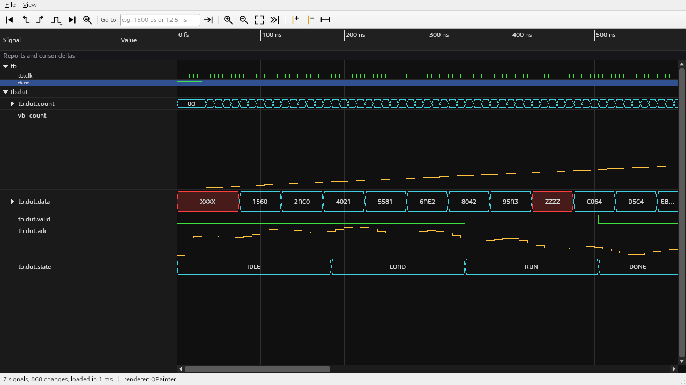

Every row has its own height in pixels, digital and analog alike (default: 22, analog traces 4 lines = 88):

- **Height...** (context menu and Wave menu): a dialog with the height in pixels (12 to 800) for all selected rows; **Default** gives
  them their default height back.
- **Drag the bottom border** of a row in the name or value column (the pointer becomes a vertical resize arrow): the row follows
  the mouse, Esc while dragging puts the old height back.
- **Alt+Down / Alt+Up** make the selected rows 2 pixels taller or lower.

Analog traces scale to the new height; bit and bus rows keep their trace and text centred, and rows lower than the font get a
smaller font (down to 8 pixels). The rows of single bits under an expanded vector keep the default height. Every change is one
undo step, and the height is saved in layouts (`heightpx=`) and in `.do` files (`add wave -height P`, pixels).

#### Stepping through edges and finding values

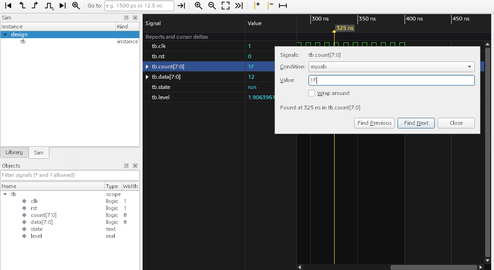

- **Next / previous edge** of the selected rows (all rows if none is selected): **Right** / **Left**, **Tab** / **Shift+Tab**, or the
  two step buttons of the wave toolbar. The cursor moves to the edge and the view scrolls only if the edge is not visible (a scroll turns
  Follow off). An edge is a time step at which the value is different from the step before: a value written again, or a glitch that
  ends inside one time step (delta cycles), is skipped.
- **Rising / falling only**: the button with the pulse icon next to the step buttons chooses *Any edge*, *Rising edge* or *Falling
  edge* for the buttons and the keys. Rising and falling look at single-bit rows: 1 bit signals and the bit rows of an expanded vector
  (click its triangle). Rising means "becomes 1 (or H)", falling "becomes 0 (or L)", from any other value.
- **Find value** (magnifier with `=`, **Ctrl+F** in the wave window): a small window that searches the selected rows. *equals* and
  *does not equal* take a value in the row's radix: hex digits for a hex row (`1F`, `X`, `Z`, `U`, `?` for any digit), `0 1 X Z U W L H`
  and `?` for binary, a decimal number (or `X`) for signed and unsigned, text for enumerations. *crosses threshold rising / falling /
  either way* works on numeric rows (real signals and vectors up to 64 bits) and takes a number. **Find Next** and **Find Previous**
  start at the active cursor and stop where the condition starts to hold; **Wrap around** (off by default) starts over from the other
  end. **F3** and **Shift+F3** repeat the last search. The result is also shown in the status bar.
- The searches run in the waveform library, not in the GUI: a binary search finds the starting point, threshold searches skip blocks
  of values with the min/max index. On a million changes a next edge takes under a microsecond, a full scan for a value that never
  occurs about 5 ms.
- Headless: `--wave-op "edge next rising"` and `--wave-op "find next 1F"` (after `--wave-op "select NAME"`) do the same for screenshots.

### The List window

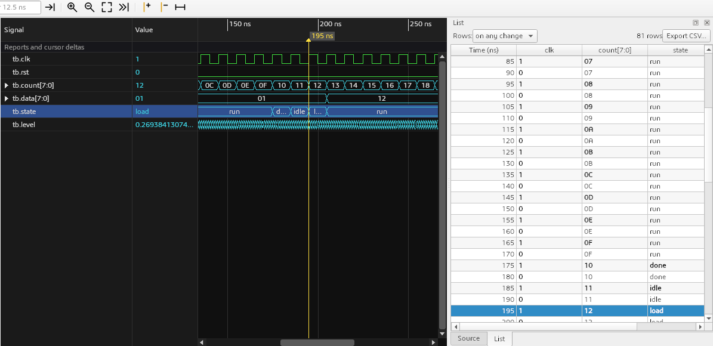

`add list /tb/clk /tb/count /tb/state` (same patterns and `-r`, `-radix`, `-label` as `add wave`), **View > List**, or dragging
signals from the Objects pane opens the **List** dock (a tab next to Source, hidden until first used): a table with the time and one column per signal.

- **Rows**: *on any change* of a listed signal (one row per time step; delta cycles at one time are one row with the last value),
  *on changes of* one trigger signal (or right click a column header > *Print rows on changes of this signal*), or *every* `10 ns`
  *from* `0 ns` (strobe). A value that changes at the row's time is bold; `-` means the signal has no value yet.
- **Columns**: right click a header for the radix, *Move left / right* and *Remove* (also the Delete key); headers can be dragged to
  reorder. Right click the time header to change the time unit.
- **Cursor**: selecting a row moves the wave window's active cursor to its time; moving the cursor selects the row at or before it.
- **Ctrl+C** copies the selected rows (tab separated, with the header line). **Export CSV...** writes every row (UTF-8, `Time (ns)` and
  the signal paths in the header, exact decimal times).
- It grows while the simulation runs and stays at the end if you scrolled there. Nothing is stored per row: a million rows cost about
  as much as a hundred (the row times come from an index with a checkpoint every 1024 rows, every cell is read when it is shown).
- `delete list *` removes all columns. There is no delta column: the waveform stream does not record delta numbers.

### The Memory window

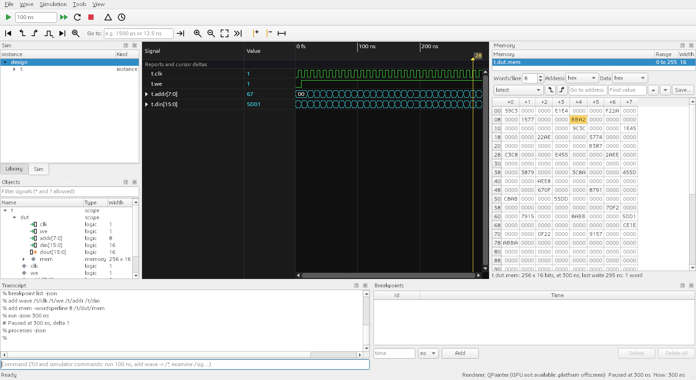

Memories are arrays of words: `type ram_t is array (0 to 1023) of std_logic_vector(7 downto 0)`, arrays of integers, the rows of an
array of arrays. They are **not recorded by default**, because the simulator writes every word of an array each time one word changes.
Turn on **Simulation > Record memories (arrays)** (kept in the settings; it takes effect at the next start or restart), or give
`-lvdarrays` to `vsim` / `lvdsim-gui`. Then:

- `add mem /tb/dut/mem` (options `-wordsperline N`, `-addressradix r`, `-dataradix r`), **View > Memory**, `view memory`, or right
  click the memory in the Objects pane > **Open in Memory window** shows the **Memory** dock (a tab next to Source). In the Objects
  pane the words of a memory are grouped under one collapsed item of type `memory` (`256 x 16`).
- The list at the top has every memory of the design; the grid shows the selected one, a line per *Words/line* words, the address in
  the *Address* radix on the left, the values in the *Data* radix.
- **Time travel**: *latest* shows the end of the recorded data and follows the run; *at wave cursor* shows the memory at the active
  wave cursor, so moving the cursor (or clicking a row in the List window) goes back through everything recorded. The two arrow buttons
  jump the cursor to the previous or next write to the memory.
- The words written at the last write at or before the shown time are marked; words never written up to then are grey. The tooltip of a
  word gives its last write time and the number of writes.
- **Go to address** takes an address in the address radix or with a prefix (`0x1F`, `16#1F#`, `x"1F"`, `0b101`); **Find value** looks
  for a value in the data radix (`?` matches any digit), from the selected word, wrapping at the end.
- **Save...** writes the memory as shown to a file that `$readmemh` reads (`$readmemb` for names ending in `.bin` or `.memb`); unknown
  digits are written as `x`. The context menu adds the selected words to the wave window or copies them.
- Verilog memories (`reg [7:0] mem [0:1023]`) are not in the waveform yet, and loading or changing memory contents from the GUI needs
  simulator support that does not exist yet.

### Expression signals, datasets and compare

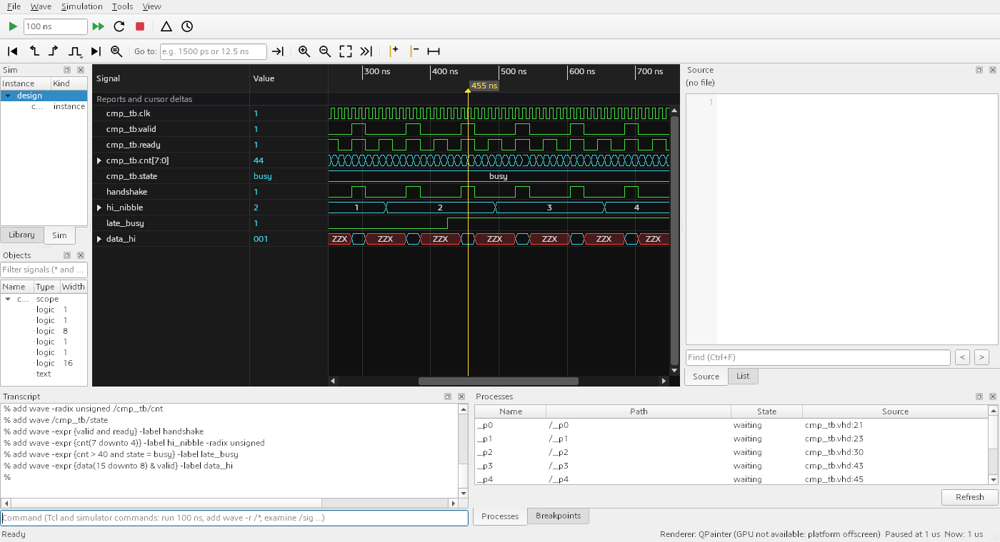

- **Add expression signal...** (wave context menu or Wave menu) adds a row computed from other signals, for example
  `valid and ready`, `cnt > 40 and state = busy`, `cnt(7 downto 4)` or `data(15 downto 8) & valid`. The dialog checks the
  text while you type and names the column of an error. From the console: `add wave -expr {valid and ready} -label handshake`.
  Double-click the row's name to edit it. It follows the run, takes a radix, a colour and the analog display, and the edge and
  value searches work on it. `add list -expr {...}` puts one in the List window.
- **File > Open dataset...** opens a finished FST file (for example a recording of a known good run) next to the simulation.
  Its signals are `ref:/tb/dut/q` in commands and expressions: `add wave ref:/cmp_tb/cnt`, `add wave -expr {cnt /= ref:/cmp_tb/cnt}`.
- **Compare with dataset > ref** (context menu, on selected signals) adds the dataset's copy and a red compare row that is high
  where the two differ; **Compare waveforms...** compares whole waveforms (optionally one scope, with a time tolerance) and adds a
  group of compare rows for the signals that differ. **Next / Previous difference** jump between differences. From the console:
  `add wave -compare -tolerance {2 ns} ref:/tb/dut/* /tb/dut/*`.

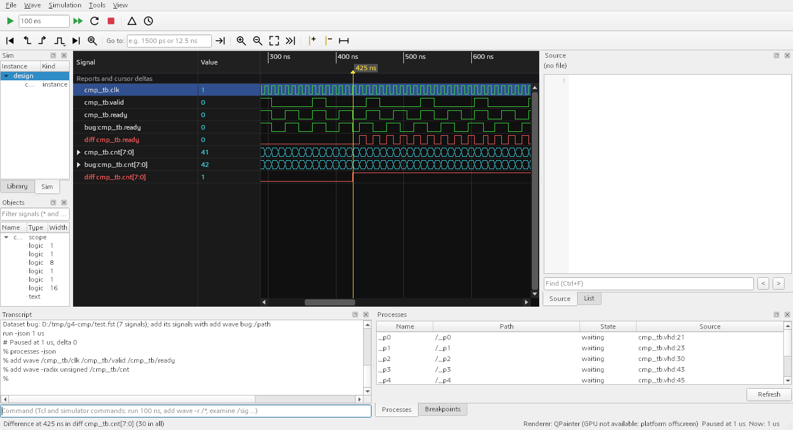

The language, the rules of the comparison and the numbers are in [expressions.md](expressions.md).

### The toolbars


Top row, left to right: **Run** with the run length next to it (`100 ns`; Enter in the box also runs), **Run -all**, **Break** (two amber
bars; ends the run that is going, see below), **Restart** (back to time zero, wave rows kept, the startup script not run again; see below),
**Stop**, **Step delta**, **Step time**, then the source
debugger's **Continue**, **Step Into**, **Step Over** and **Step Out** (see
[the source debugger](#the-source-debugger-line-breakpoints-stepping-call-stack-and-variables)).
Bottom row: go to start, previous and next edge, the edge kind (any, rising, falling), go to end, **Find value**, **Go to**, zoom in,
zoom out, zoom fit, Follow, add cursor, remove cursor, add divider.
Hover a button for its tooltip. The menus mirror the actions:


**Restart** (also `restart` typed in the transcript) normally happens inside the running simulator: the kernel goes back to time zero in
the same process (a few tens of milliseconds), keeps the Tcl procedures and variables, the breakpoints and the forces, and the wave
window shows the new run from time zero (cursors and the selection are cleared, the rows stay; the event band and the hit counts of
line breakpoints start again). A restart while a process is stopped at a source line finishes that cycle first. When a library the
simulation uses was analysed again since the start (the kernel would keep the old design), or when files of the open project changed
(they are analysed first), the GUI starts a new simulator process instead and says so in the transcript. Coverage counts add up over
restarts in the same process (see [Code coverage](#code-coverage)).

### Break and Stop

**Break** (toolbar, Simulation > Break, Ctrl+Break) ends the run that is going, for example a `run -all` on a clock that never stops, at
the simulation time it has reached: the kernel finishes the current time step, the run replies, and the status bar says
`Interrupted at 8187585 ns` (the transcript: `# Interrupted at ..., delta ... (Break); Run goes on from here`). The waveform, the List and
the Memory windows show everything up to that time. Nothing is lost: **Run** (or `run 100 ns`) goes on from there, Run -all to the end,
and time breakpoints you had set still apply, as after a breakpoint. Commands typed in the transcript while the run was going wait in the
simulator's input and run right after the break. Break is only enabled while a run (or step) is going; at the prompt, and while a process is
stopped at a source line (use Continue or the steps there), the simulator ignores it. In `vsim` scripts `run -continue` after a break is the
default run, as after a time breakpoint.

A process that loops without ever reaching a `wait` never gives control back to the kernel, so the run cannot end there. Pressing Break a
second time then asks: **Wait** (press Break again later) or **Kill** the simulator (the waveform up to then stays on screen).

**Stop** ends the simulator. A run that is going is broken first, then the simulator is asked to exit; it writes its coverage counts and the
end of the waveform. When it has not exited after 3 seconds a dialog says **The simulator has not exited yet**: **Wait** gives it another 3
seconds (and asks again), **Kill** ends it at once. When the simulation collects coverage, the dialog says that killing it loses the
coverage counts it writes at exit. Closing the window with a simulation running, and starting another simulation, use the same dialog.
Headless runs (`--screenshot`) and the tests never show it: there the simulator is killed after the timeout, as before.

On Windows the break is a console Ctrl+Break sent to the simulator alone (it runs in its own process group); on Linux it is SIGINT.
The simulator reacts the same way to Ctrl+C typed in a terminal running `nvc -i` or `vsim -c`.

### The transcript

Type any Tcl or simulator command in the line at the bottom of the window. The commands below were sent to the running
`mixed_language` session with `--send` (the transcript text is exactly what the program saved):

```
% run -json 500 ns
# Paused at 500 ns, delta 2
% examine /events
"00000001"
% force /rst '1'
% run -json 100 ns
# Paused at 600 ns, delta 1
% noforce /rst
% run -json 100 ns
# Paused at 700 ns, delta 2
% examine /avg
"00101001"
```

(`run` and `step` are sent with `-json` inserted: the GUI parses the machine-readable reply. You type plain `run 100 ns`.)
A VHDL `std_logic` force needs the quotes, `'1'`; an unquoted `1` is an error from the kernel. The forced reset is visible in the `rst` row:


Note that `examine` cannot print `real` signals yet; look at them in the wave window.

#### Console comfort: history, completion, multi-line commands, links

- **History.** Up and Down walk through the commands typed before (also in earlier sessions: the last 1000 are kept per user in
  the settings, key `console/history`; the limit is `console/historyLimit`). A command typed again moves to the end instead of
  appearing twice. **Ctrl+R** opens a search line above the command line: type part of an earlier command, Ctrl+R again for an
  older match, Enter runs it, an arrow key or Tab takes it for editing, Esc puts back what you had typed. **Transcript > Command
  history...** lists the history newest first with a filter; Insert puts a command into the command line, Run sends it.
- **Tab completion.** Tab completes the word at the cursor: command names (the built-in ones at once; the first Tab on a command
  name also asks the running shell for `info commands`, so your own `proc`s are offered too, and a `proc`, `do` or `source` makes
  it ask again), sub-commands and options of the common commands (`add wave -r`, `run -all`, `step -over`, `examine -radix hex`),
  design paths as the shell names them (relative to the top: `/u_sub/a`; any case, the design's spelling is inserted; a scope ends
  in `/` so the next Tab goes inside it), and file names after `do`, `source`, `vcom` and `vlog`. With several candidates the
  common part is inserted and a list opens: keep typing to narrow it, Up/Down to choose, Enter or Tab to take it, Esc to close.
- **Multi-line commands.** Enter on an unfinished command (an open brace, bracket or quote, or a line ending in a backslash) does
  not send it: the command line grows and the next line starts with `>`. Shift+Enter starts a new line on purpose. Pasted lines are
  sent one command at a time (so `run` keeps working as usual); a command that spans lines is sent to the shell as
  `eval "..."` on one line, which is what the transcript shows.
- **The transcript.** `** Error`, `** Warning` and `** Note` lines are coloured. File references, `tb.vhd:17` and the
  `(file "run.do" line 2)` lines of a Tcl error, are links: a click opens the file at that line in the Source window. Ctrl+F (with
  the focus in the transcript) opens a find bar (Enter or F3 next, Shift+Enter or Shift+F3 previous, it wraps around). The
  **Transcript** menu and the transcript's context menu have Save transcript..., Clear transcript and Copy without prompts (the
  selection, or everything, without the `% ` prompts: ready to paste into a `.do` file). The transcript keeps the last 20000 lines
  (`console/maxLines`).
- **Do files.** Drop a `.do` or `.tcl` file on the console to run it with `do`; **Transcript > Run do file...** does the same with
  a file dialog, and **Transcript > Recent do files** lists the last ten scripts run with `do` (typed, dropped or chosen).

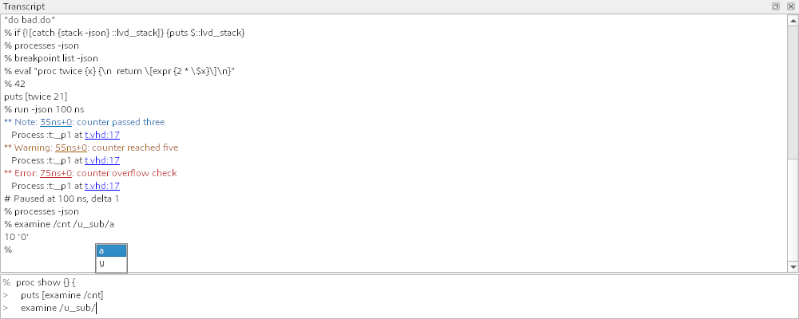

### Library, Sim and Objects docks


- **Library** lists the compiled units of `work` (and of every library folder, see [section 5](#5-vendor-libraries)): entity,
  elaborated design. Double-click a unit or an architecture to see its source (it never starts a simulation; **Simulate** in the
  context menu does).
- **Sim** is the instance tree of the elaborated design (`design` > `tb_mixed`, expandable). Selecting a scope chooses what Objects
  lists; double-click an instance to see its architecture (or module, or the block / generate statement).
- **Objects** lists signals with their type and width; the filter box accepts `*` and `?`. Rows are added to the wave window with `add wave`. The left column is
  narrow by default, so long names are cut: drag the splitter to widen it. Return, **Add to Wave** in the context menu or a drag
  adds the selected signals at the end of the wave window; a **double-click shows the declaration** (next section).

#### Where is it declared? View Declaration, View Definition, View Instantiation

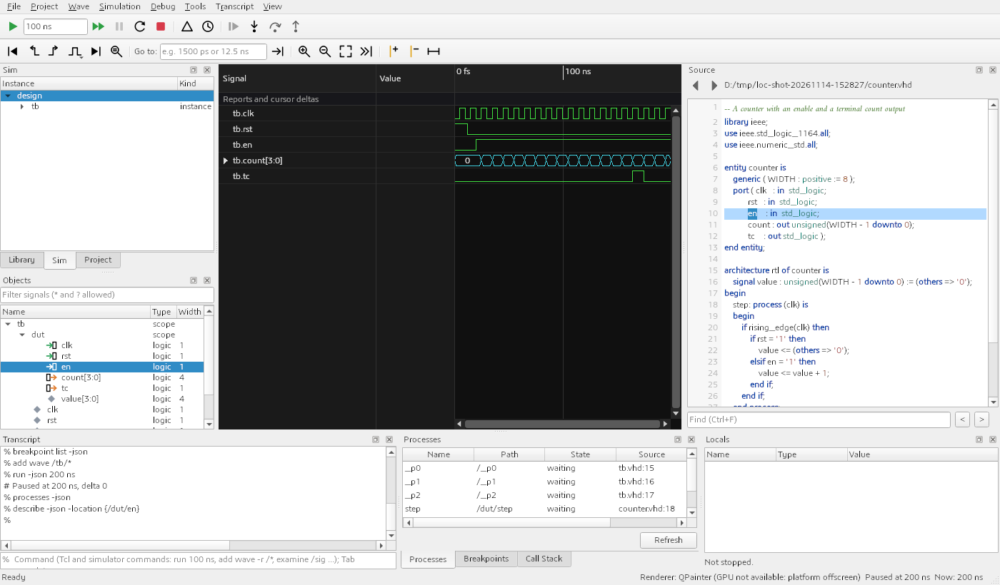

Double-click a signal in **Objects** and the **Source** dock opens the file where it is declared, at that line, with the name selected
and the line flashing for a moment. A port shows its own port declaration even when the simulator merged it with the signal it is
connected to (`dut.en` above opens the `en` port of `counter`, not the `en` of the test bench). The simulator says where things are
(kernel change set 42, `describe -location`, see [protocol.md](protocol.md), "Source locations"); the GUI asks once per name and session.

| Where | Action | Opens |
|-------|--------|-------|
| Objects | double-click, or context menu **View Declaration** | the declaration of the signal, port, Verilog net or variable (a memory: the array) |
| Objects | context menu **Add to Wave**, **Add to List**, **Add to Memory** (memories), **Copy Path** | as named; Return adds to the wave |
| Sim | double-click, or **View Definition** | the architecture (entity instance), the module (Verilog instance), the bound unit (component instance), the block or generate statement |
| Sim | **View Instantiation** | the statement in the parent that creates the instance (not for the top level) |
| Processes | double-click, Return, or **View Source** | the process statement |
| Wave (name column), List (column header) | **View Declaration** | the declaration of the signal of the row or column (not for expressions, buses or datasets) |
| Locals | **View Declaration** | the declaration of a variable of the stopped process |
| Library | double-click, or **View Source** | the unit's source: the file of the open project that declares it, otherwise the file nvc names for it (VHDL units; Verilog modules only through a project) |
| console | `describe -location /dut/width` | prints the location; generics, constants and process variables are found by path too |

**Back** and **Forward** (the arrows above the Source text, or Alt+Left and Alt+Right in the Source dock) walk through these jumps;
each place remembers the line you moved to before leaving it. The stop marker of the debugger, breakpoints and coverage annotations stay
where they are.

The entries are greyed out, with a tool tip that says why, when no simulation is running or when the simulator does not report source
locations (an nvc without the lvdsim change; the GUI asks it once at the first prompt). File names come from the simulator as they were
given at analysis; a relative name is looked up in the folder the simulation started in, the project folder, the library folders and
the coverage folders. A file found nowhere is reported in the transcript with the folders searched.

#### Drag signals from Objects, and the direction icons

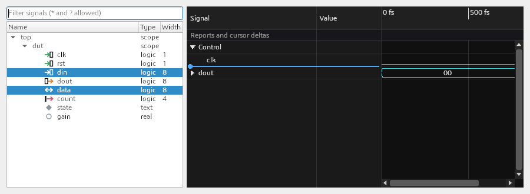

Select one or many signals (a scope stands for all of its signals) and **drag** them onto the wave window. The pointer carries a small
picture with the first names and the count. Drop on the name column, the value column or the waveform area: a blue line shows the row
position, a highlighted group row means "into this group", below the last row (or on an empty window) means "at the end". The
pointer shows "not allowed" over the ruler and the scroll bars, and the list scrolls near its top and bottom edge. The drop does what
`add wave /top/dut/clk ...` does (default radix, vector bits, signals already shown are added again) and is **one undo step**
(Ctrl+Z); the new rows are selected. The drag carries the `add wave` paths as plain text too, so you can drop them into the transcript.

The icon in front of each signal tells how it reaches its region:

| Icon | Meaning |
|------|---------|
| green arrow into a box | `in` port |
| orange arrow out of a box | `out` port |
| blue double arrow | `inout` port |
| red arrow out of a bar | `buffer` port |
| grey diamond | internal signal |
| grey ring | direction not known |

The tooltip of a row says the same in words. The icons are drawn as vectors, so they are sharp at 150% scale
(`images/objects_port_icons_150.png`), and the box outlines follow the theme. The simulator reports the modes in the waveform stream
(kernel change set 04, see [protocol.md](protocol.md), "Port mode"), for VHDL ports and for the ports of Verilog modules instantiated from
VHDL; a kernel without it gives the grey ring everywhere, and so do `linkage` ports.

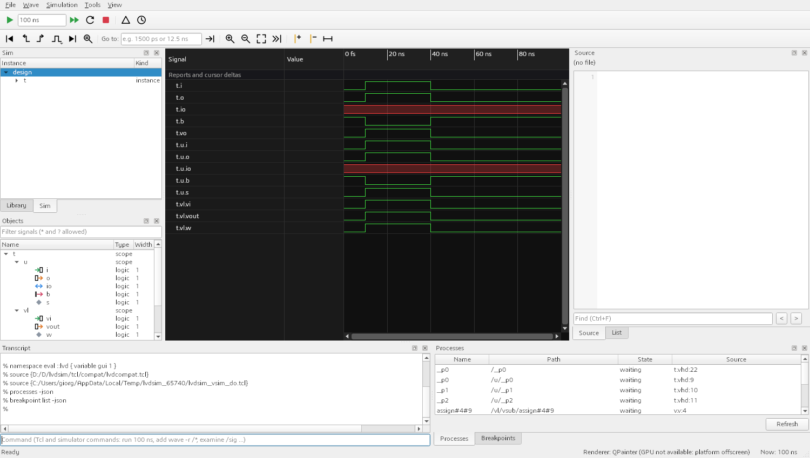

The waveform of a run ends where the run ended, not at the last value change: after `run 100 ns` on a design whose last event is at
40 ns the data reaches 100 ns, and the next `run 100 ns` continues to 200 ns (kernel change set 05).

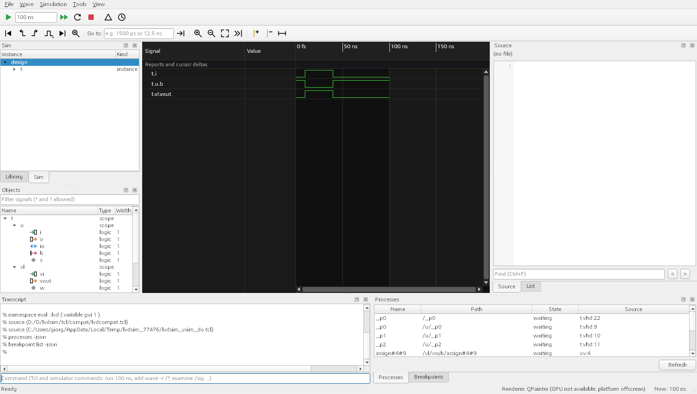

### Processes, Source and Breakpoints, stepping

Start the design without a startup script, add some rows, set a time breakpoint, run, then step two cycles:

```sh
lvdsim-gui work.tb_mixed
```

and in the transcript (or with `--send` from a script):

```
% add wave /clk /sample /avg /events
% breakpoint add 500 ns
1
% run 2 us
# Breakpoint 1 hit at 500 ns (now 500 ns, delta 2)
% step -delta
# Paused at 510 ns, delta 0
% step -time
# Paused at 510 ns, delta 1
```


- **Processes** lists every process with its path, state and source file and line. Double-click one (or **View Source** in its context
  menu): **Source** opens the file with the process line highlighted (with the Source dock showing `(no file)` until you select a process; on the command line use
  `--process convert`). **Step delta** runs one simulation cycle, **Step time** finishes the current time step. Both are simulation
  cycles, not source lines. The status bar shows `Paused at 510 ns`.
- **Breakpoints** (tabbed with Processes) handles time breakpoints: one shot, absolute time. Type a time and a unit and press Add, or use
  `breakpoint add 500 ns`. A breakpoint that was hit is removed, so the list below shows two that are still pending:


`when` conditions are not implemented ([command-compat.md](command-compat.md)). Source line breakpoints are, see the next section.

### The source debugger: line breakpoints, stepping, call stack and variables

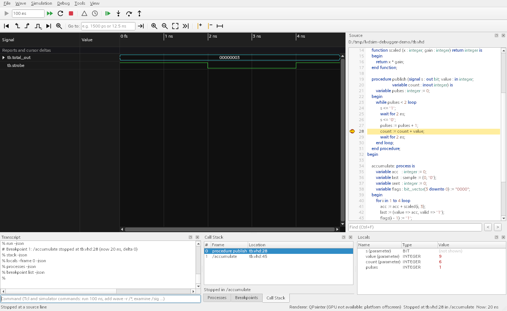

The picture shows a test bench whose process calls a procedure that waits. It was taken with

```sh
lvdsim-gui --hide-dock library --hide-dock structure --hide-dock objects -do "add wave -r /*" work.tb \
    --send "run 5 ns" --send "breakpoint add tb.vhd:28" --send "run" --send "run" --screenshot debugger.png
```

- **Set a breakpoint**: click in the grey gutter of the Source dock, left of the line number (or put the cursor on the line and press F9,
  Debug > Toggle breakpoint). A red dot appears; a second click removes it. Breakpoints belong to the design (working directory and top
  unit) and are kept in the settings: they come back the next time the design is started, and they are set again at every start and
  Restart, before the startup script runs (so `vsim -do "run -all"` stops at them). Without a simulation the dot is planned and sent
  when one starts. `breakpoint add tb.vhd:28` typed in the transcript works too and shows up in the gutter and the list.
- **Looks**: red dot - set; red ring - disabled (kept, not in the simulator); grey dot - the simulator refused it (the tooltip and the
  Breakpoints list say why) or the line has no statement (empty or only a comment), so it is never reached.
- **When a process reaches the line** the run is suspended. The Source dock opens the file at that line with a **yellow arrow** and a
  yellow line; the status bar says `Stopped at tb.vhd:28 in /accumulate` and shows the simulation time of the stop. The waveform shows
  what was written up to the last completed run; the rest arrives when the run goes on.
- **Verilog `$stop`** suspends the run the same way, without a breakpoint (kernel change set 36): the yellow arrow marks the `$stop`
  line, the status bar says `Stopped by $stop at tb.v:5` (`Stopped by $stop` when the simulator gives no source line), the transcript
  `# $stop: /initial#3#2 stopped at tb.v:5 (...)`. Call Stack, Locals and `examine` work as at a breakpoint; **Continue** goes on
  after the `$stop`. VHDL `std.env.stop` is different: it ends the simulation, as in batch runs.
- **Debug toolbar and menu** (enabled only when they make sense):
  - **Continue** (F5): resume the run (`run`). It stops at the next breakpoint (or `$stop`) or ends.
  - **Step Into** (F11): run until any process starts a new statement, entering called functions and procedures. Also works when
    nothing is stopped: it runs to the first statement.
  - **Step Over** (F10): run the stopped process to its next statement in the same subprogram, calls included (after a `wait` it stops
    when the process resumes).
  - **Step Out** (Shift+F11): run until the current subprogram has returned to its caller.

  While a process is stopped the simulator refuses `run` with a time, `force`, `noforce` and the cycle steps (**Run**, **Step delta**
  and **Step time** are disabled then; typed, the kernel's error appears in the transcript and the status bar). **Run -all**, `run`
  and `run -continue` resume. `examine`, `describe`, `processes`, `breakpoint` and other commands work as usual.
- **Call Stack** (a tab next to Processes and Breakpoints): the frames of the stopped process, innermost first. Select a frame to see
  where it is: the Source dock moves to the call with a **green arrow**, and Locals shows the variables of that frame.
- **Locals**: name, type and value of the variables of the selected frame (process variables; variables and parameters of procedures
  that can wait). Records and arrays written as aggregates, `(value => 9, valid => '1')` or `(1, 2, 3)`, can be expanded field by
  field. Values that differ from the previous stop in the same frame are **red**. Values the simulator cannot show (access, file and
  protected types, signal parameters) read `(not shown)`; functions and procedures that cannot wait show no variables in this version.
- **Breakpoints** lists time breakpoints first, then line breakpoints with a check box (enable or disable), the number of stops and the
  state. Double-click a line breakpoint to show it in Source; Delete and Delete all remove both kinds.

The same typed in the transcript (the commands are native kernel commands, see [nvc-tcl-commands.md](nvc-tcl-commands.md); the GUI
inserts `-json` into `run` and `step` and summarises the reply, its own `stack -json` and `locals -json` requests are left out here):

```
% breakpoint add tb.vhd:28
1
% run -json
# Breakpoint 1: /accumulate stopped at tb.vhd:28 (now 2 ns, delta 0)
% step -json -over
# Step: /accumulate stopped at tb.vhd:29 (now 2 ns, delta 0)
% stack
{level 0 kind procedure name publish symbol WORK.TB.PUBLISH(sJII) file tb.vhd line 29} {level 1 kind process name /accumulate ...}
% locals
{name s kind parameter type BIT value {}} {name value kind parameter type INTEGER value 3} ... {name pulses kind variable type INTEGER value 1}
% breakpoint delete all
% run -json
```

In a batch script (`vsim -c`) the shell prints `breakpoint 1 in /accumulate at tb.vhd:28` and then reads commands from standard input;
give such a breakpoint a `-command` script that ends in `run` to keep the script going.

A `$stop` in a batch run ends the simulation like VHDL `stop`: a plain `nvc -r` and the runs of `lvdsim-cli regress` without a script
print `$stop called` and exit with code 0. In a `-do` script of `vsim -c` (and in regression tests with a do script or commands) the
shell prints `$stop in <process> at <file>:<line>` and reads standard input as at a breakpoint; at the end of input (the regression
runner gives none) it finishes the time step and later `run` commands do nothing, as after VHDL `stop`. `vsim -c` without `-do` is the
interactive shell: there `$stop` waits at the prompt and `run` continues. Either way the regression verdict does not count the
stop: it passes unless the exit code, errors, failures or the expected output say otherwise. Use `$finish` or `$fatal`/an assertion to make
the end or a failure explicit.

### Code coverage

nvc counts statements, branches, expression terms, signal toggles (per bit), FSM states and functional cover points when the design
is elaborated with `--cover`. It writes the counts into a coverage database (`<top>.ncdb`) at the end of a run. The **Coverage** dock
shows such a database: the instance hierarchy with a coloured bar per kind (the numbers of a row include the instances below it; the
tool tip also gives the instance alone), a filter, **Uncovered only**, and below it the details of the selected instance: the lines with
something not covered, toggles per signal and bit (`0 -> 1 / 1 -> 0` counts, "cannot toggle" for a signal nvc knows to be constant)
and FSM states. Selecting an instance or a detail shows its source; the Source gutter then has a count column (green: everything on the
line covered, amber: part of it, red: nothing) and the lines with something missing are tinted. Breakpoint dots and the debugger arrow
keep working on the same gutter.

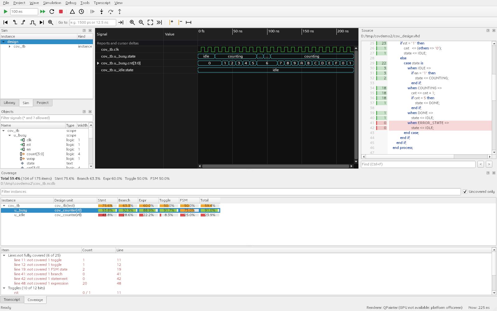

The design in the picture is `tools/tests/data/coverage/cov_design.vhd` (two counters, one held in reset), simulated with Simulation >
Collect coverage on and `run -all`; the dock filled when the simulation reached its end (made with `lvdsim-gui -coverage -do "add wave
...; run -all" --coverage-refresh --coverage-select /cov_tb/u_busy --coverage-uncovered --screenshot coverage.png work.cov_tb`). A batch run that collects
everything, a second shorter run, a merge and nvc's HTML report (the output is what nvc printed):

```
> nvc --std=2008 -a cov_design.vhd -e --cover=all cov_tb -r
> nvc --std=2008 -e --cover=all --cover-file=short.ncdb cov_tb -r --stop-time=40ns
> nvc --cover-merge -o merged.ncdb cov_tb.ncdb short.ncdb
> nvc --cover-report -o html cov_tb.ncdb
** Note: code coverage results for: WORK.COV_TB
** Note:      statement:     75.6 % (31/41)
** Note:      branch:        63.3 % (19/30)
** Note:      toggle:        50.0 % (38/76)
** Note:      expression:    60.0 % (12/20)
** Note:      FSM state:     50.0 % (4/8)
** Note:      functional:    N.A.
** Note:      average:       59.4 % (104/175)
```

In the window:

- **File > Open coverage...** loads one or more `.ncdb` files; several are merged (counts added, hierarchies joined). The GUI runs
  `nvc --cover-export --format=json` (an nvc without the JSON export answers "unknown format"; the GUI then uses `--format=xml`) and
  reads the result; it never reads the database format itself. nvc keeps the source names as they were analysed (often relative,
  `src/top.vhd`): the Source pane looks for them next to the database first, then in the working directory.
- **File > Save merged coverage...** writes the loaded databases as one (`nvc --cover-merge`).
- **File > Coverage HTML report...** writes nvc's HTML report into a folder (`nvc --cover-report`) and opens its `index.html`.
- **Simulation > Collect coverage** elaborates the next simulation (start or restart) with `--cover=statement,branch,expression,toggle,`
  `fsm-state,functional --cover-file=<dir>/<top>.ncdb`, the same as `vsim -coverage`; the setting is kept. `<dir>` is the working
  directory (the project folder when a project is open); when that is not writable (a program folder), the GUI puts the database in
  its data folder (`data/coverage` of a portable installation, else the user's application data) and says so in the transcript.
  `-lvdcoverfile F` on the Start line chooses the file (relative to the working directory). The GUI always gives nvc an absolute name.
- The dock fills by itself **when the simulation reaches its end** (`run -all` with no more events, `std.env.finish`, `$finish`) and
  **when the session ends** (Stop, or a new start): nvc's shell writes the counts at exit and the dock loads them.
- **Simulation > Refresh coverage** shows the counts so far while the simulation runs: the GUI sends `coverage save -json`, the
  simulator writes the database and the dock reloads it, keeping the instance you selected. **Counts add up over restarts:** a Restart
  in the running simulator keeps the coverage data, so after `run`, Restart, `run` every count is the sum of both runs (like two batch
  runs into one database). For the counts of one run only, stop the simulation and start it again (Simulation > Start), which
  elaborates anew. The new elaboration writes `<top>.ncdb` again: the dock keeps showing the previous counts, and Save merged coverage
  and the HTML report use a copy of them, until you refresh or open another database.
- **Verilog:** nvc collects code coverage of VHDL only. A Verilog or SystemVerilog top gives an empty database (the dock says so), and
  in a mixed design the Verilog instances have no coverage rows; their VHDL parents and children are counted as usual.
- Headless: `lvdsim-gui --coverage cov_tb.ncdb --coverage-select /cov_tb/u_busy --coverage-uncovered --show-dock coverage
  --screenshot out.png` (also `--coverage-filter TEXT`; `--coverage` can be repeated to merge). With a simulation:
  `lvdsim-gui -coverage --send "run -all" --coverage-refresh --coverage-select /top --screenshot out.png work.top`.

The percentages count every bin (a branch has a true and a false bin, a toggle a rise and a fall) as nvc's report does, and agree
with it for the design above. Excluded bins count as covered, as in the report: those flagged in the database (an exclusion of the
design or of `--cover-spec`), and with `--cover=...,exclude-unreachable` the toggles and expression terms nvc knows cannot happen.
The dock itself has no exclude file (nvc's report takes one, `nvc --cover-report --exclude-file=FILE`).

### Projects, compiling and regressions

A **project** (`.lvdproj`, a short text file) lists the libraries with their source files, the tests and a few settings; the
**Project** menu creates, opens, saves and imports one (**Import compile script (.do)** turns the `vlib`/`vmap`/`vcom`/`vlog`/`vsim` lines
of an existing script, and the mappings of `lvdsim.ini`, into a project). Opening a project makes its directory the working directory.

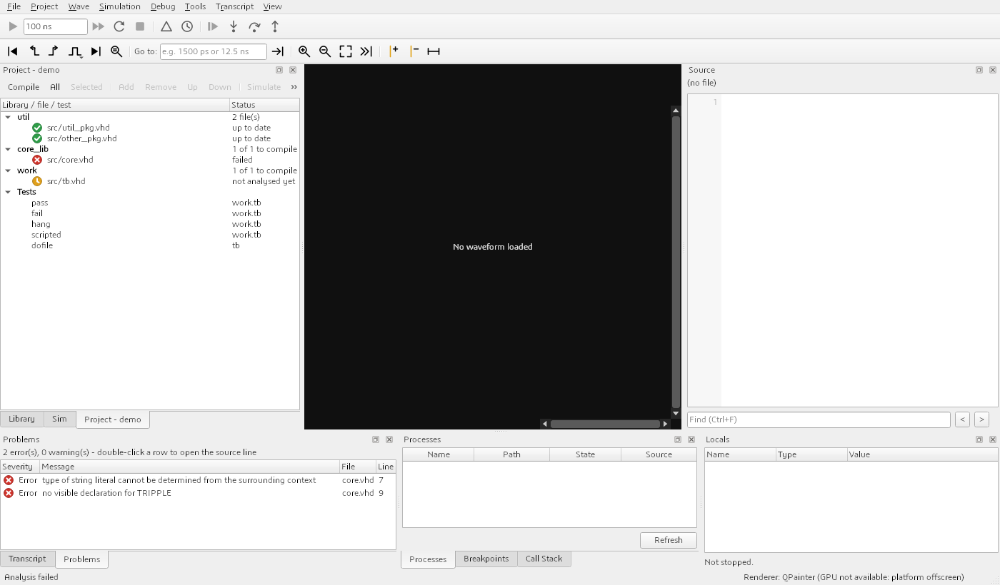

- The **Project** dock (a tab next to Library and Sim) shows every library with its files and a status icon per file: green up to date,
  amber out of date (with the reason: changed, options changed, depends on another file, not analysed yet), red failed, a dashed ring
  for a missing file. **Compile** (F7, Project > Compile out-of-date) analyses only the files that changed and the files that depend
  on them, in dependency order; **All** analyses everything, **Selected** the selected file and its dependents. **Add...**, **Remove**,
  **Up** and **Down** edit the file list (also in the context menu). Double-click a file to open it in Source.
- Errors and warnings of an analysis go to the **Problems** dock; double-click a row to open the file at that line.
- Double-click a test (or **Simulate**) to analyse what is out of date and start that test in the simulator, with its generics and
  script.
- **Regress** (Project > Run regression) runs the tests as batch simulations, several at a time, in the **Regression** dock: status,
  time, number of errors and the first message per run; **Rerun failed**, **Log** (opens the run's log in Source), **Wave** (opens the
  run's waveform as a dataset, when the project records waveforms), **Coverage** (the coverage merged over all runs, when the project
  collects it) and the number of parallel **Jobs**.

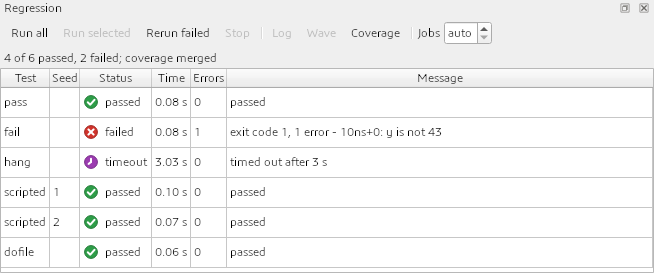

The same from the command line, for scripts and CI: `lvdsim-cli compile demo.lvdproj`, `lvdsim-cli regress demo.lvdproj -j 4 --junit
results.xml` and `lvdsim-cli project import compile.do`. The file format, the rules for pass and fail and every option are in
[projects.md](projects.md).

### The GPU renderer switch

All wave rows are drawn through one renderer interface. There are two renderers: a GPU renderer (a QRhi tile atlas, Direct3D 11 on
Windows) and a QPainter tile renderer that works everywhere. **The GPU renderer is the default.** If the GPU cannot be used (remote
desktop, virtual machine, offscreen platform, a driver error) the window falls back to QPainter by itself, prints one line about it
in the transcript the first time, and the status bar at the bottom shows what is drawing: `Renderer: GPU`, or
`Renderer: QPainter (GPU not available: reason)`.

**View > Waveform renderer** has three exclusive entries:

- **Automatic** (the default): ask for the GPU, fall back to QPainter when it fails.
- **QPainter only**: never use the GPU.
- **GPU only**: ask for the GPU too; a failure is still reported and the window still falls back, so you never get a blank wave pane.

The choice is stored in the settings file (key `render/backend`: `auto`, `cpu` or `gpu`). The environment variable `LVDSIM_RENDERER`
(`auto`, `cpu`, `qpainter`, `gpu`) overrides the stored choice for one run:

```bat
set LVDSIM_RENDERER=cpu
lvdsim-gui -do sim.do work.tb_mixed
```


The screenshot option `--open-menu` opens only the top-level menu, so the submenu itself is not shown; the three entries are the ones listed above.


The GPU shot was taken in a real window with the default policy on a display with 150 percent scaling and reduced to 1400x800 here;
the offscreen screenshots elsewhere in this tutorial always use QPainter (they show `Renderer: QPainter (GPU not available: ...)`).
Tiles are rasterised at logical resolution, so on high-DPI screens GPU output is slightly softer than QPainter.

Why the GPU is the default: on a 3840x2160 wave window with many analog rows, `bench_paint` measures (CPU = QPainter, GPU):
a cold full-zoom frame 35.7 / 27.4 ms, a warm one 4.9 / 1.7 ms, a zoom step on average 10.4 / 11.5 ms, a pan step 5.9 / 1.8 ms. Panning
is 3 to 5 times faster, cold frames are about equal.

### Saving the wave format

**File > Save wave format (.do)...** writes the wave window as `add wave` commands; **Load wave format (.do)...** adds them back to
a running simulation (after a simulation has started, so the signals are known). **Save/Load wave layout** keep the lvdsim-specific
layout (virtual buses, collapsed groups). After adding a hex row to the example, the saved file reads:

```tcl
# lvdsim wave layout: familiar add wave commands (virtual bus, group collapse and show-bits are lvdsim extensions)
add wave -divider {Analog front end}
add wave -format analog-interpolated -min 0 -max 3.2999999999999998 -height 88 /tb_mixed/vin
add wave /tb_mixed/clk
add wave -radix unsigned {/tb_mixed/sample[7:0]}
...
add wave -radix hex -label sample_hex {/tb_mixed/sample[7:0]}
```

Loading it into a fresh session of the same design (the transcript says `Loaded 10 row(s) from ...mixed_wave.do`) restores all rows:


## 4. Reports in the transcript and the event band

`examples/reports` prints a report of every severity at different times. NVC prints each as `** Note: 100ns+0: text`; lvdsim turns
the time stamp into a link. Compile and run it:

```sh
cd examples/reports
vlib work
vcom -2008 -work work src/tb_reports.vhd
lvdsim-gui -do "add wave -r /*; run 3 us" work.tb_reports
```

(`src/mon.v` is a Verilog `$display` module that stays plain text because Verilog prints no time stamp.) The transcript after the
run:

```
** Note: 100ns+0: reset released
** Warning: 250ns+0: fifo almost full
** Note: 300ns+0: burst one
** Note: 300ns+0: burst two
** Warning: 300ns+0: burst three
** Error: 500ns+0: checksum mismatch
** Note: 1500ns+0: late note at one and a half microseconds
** Failure: 2us+0: fatal condition, stopping
```

(each followed by a `Process :tb_reports:_p2 at src/tb_reports.vhd:21` line). The time stamps are underlined in the colour of
the severity: note blue, warning amber, error red, failure magenta. Click one and cursor 1 jumps to that time in the wave window (the
view scrolls only if the time is outside it). Hover shows the exact time in femtoseconds.


Each report also puts a coloured arrow in the band under the ruler. Arrows that fall into the same pixel column merge into one (the
most severe colour wins; the tooltip has the count), so the cost does not grow with the number of reports. Click an arrow to move cursor 1
to its first event.


Both screenshots come from sessions that had cursor 1 placed at 500 ns with `--cursor 500000000`, which is what clicking the `500ns+0` link does.
Details: [gui-reports.md](gui-reports.md).

## 5. Vendor libraries

lvdsim never ships Xilinx or Altera sources. It compiles the simulation libraries from **your own** Vivado or Quartus installation.
Two ways: the scripts `scripts/libs/compile_libs.sh|.bat`, and the dialog in the GUI that runs them. Both are described in
[libraries.md](libraries.md); tested with Vivado 2022.2 and Quartus Pro 24.2 only.

### Tools > Compile libraries...


Pick the vendor. The dialog proposes the installations it finds, and the libraries the scripts build by default:


For the Xilinx default set (unisim, unimacro) expect about two minutes; the Altera default set takes a few seconds. Press **Start**. The
window never blocks: the log shows the script output as it comes, the progress bar counts libraries, **Cancel run** stops the whole
process tree. This is the Altera run on this machine:


With **Use these libraries in simulations** ticked, the output folder joins the library folders: every simulation started from the
window gets `-L altera_mf -L lpm ...` for the libraries found there, and the Library dock lists them. You still analyse your own
design with `vcom -L ...` as usual. The script also writes a `lvdsim.ini` in the output folder mapping the library names.

### Using the libraries: examples

**altera_mf** (the Altera example; no Quartus files in the repository). Compile the libraries once into a folder, then:

```sh
cd examples/altera_mf
LVDSIM_INI=/d/libs/altera/lvdsim.ini sh ./run.sh --batch        # your output folder; without --batch the GUI opens
```

```
** Note: 26ns+0: sum=61 cnt=3 ram=90
** Note: 26ns+0: PASS
```

In the GUI (`sh ./run.sh` with no argument does this, with `sim.do`; by hand, `lvdsim.ini` found through `LVDSIM_INI`, the libraries given with `-L`):

```sh
LVDSIM_INI=/d/libs/altera/lvdsim.ini lvdsim-gui -L altera_mf -L lpm -do "add wave -r /*; run -all" work.alt_demo
```


The Quartus Pro `altsyncram` model supports Arria 10 and Cyclone 10 GX only, hence `intended_device_family => "Arria 10"` in the example.

**vivado_unisim** (`examples/vivado_unisim`) and **xpm_unisim** need the Xilinx libraries: build `unisim`, `unimacro`, `unisim_v` and `xpm`
with the dialog or the script, then follow the README of each folder. `stress_10k` (about 10 000 signals, 118 lanes of VHDL, Verilog,
SystemVerilog and unisim cells) is the large run for the kernel and the viewer. The step-by-step commands and expected results are in
[examples/README.md](../examples/README.md) and [examples/xpm_unisim/README.md](../examples/xpm_unisim/README.md). Those two Xilinx
flows were not repeated for this tutorial; their results come from the earlier test runs recorded there and in [libraries.md](libraries.md).

## 6. The command line and batch flow

Without a window the same design runs as a batch job: the simulation is driven by a script and the result is printed or saved.
This is the flow for regressions and for machines without a display. Compile as in [section 2.1](#21-prepare-the-design-once), then
simulate 2 us without a GUI and print two signals:

```sh
cd examples/mixed_language
vsim -c -do "run 2 us; puts [list events [examine /events] avg [examine /avg]]; quit" -lvdwave mixed.fst work.tb_mixed
```

```
events {"00000010"} avg {"00101110"}
```

`-lvdwave mixed.fst` saves the waveform (`mixed.fst`, about 3 KB) as FST, a file you can keep, compare or open in other tools. The
same flow is in `run.sh --batch` and `run.bat --batch` of the example (without `--batch` they open the GUI instead). A batch run has no window to follow, so a file is the way to look at its result
afterwards. Signal paths start at the testbench instance: write `/events`, not `/tb_mixed/events`.

A `.do` file is a plain Tcl script run by `-do`. `vsim -c -do sim.do work.tb_mixed` runs the one from section 2: the `add wave` lines are
accepted and have no effect without a window, `run 2 us` simulates and the shell ends when the script does. A free-running design such as
this one (its clock never stops) needs a time on `run`; `run -all` is for designs that end by themselves.

Without `-do` you get the interactive Tcl shell of the kernel; type `help` for its commands and `quit` to leave:

```
$ vsim -c work.tb_mixed

nvc 1.24-devel (754af76cc) (Using LLVM 23.1.5)
...
Type help for a list of supported commands.

%
```

## 7. Common problems

1. **Another simulator's `vcom`, `vlog` or `vsim` runs instead.** Check `where vcom` (or `which vcom`). The lvdsim folder must come first
   on `PATH`; with the package, the programs next to `lvdsim-gui.exe` always know their own nvc.
2. **An error about a missing `work` library.** Run `vlib work` first, in the folder where you compile. Libraries are directories; names map through
   `lvdsim.ini` (`[Library]` section) in the current folder, or the file named by `LVDSIM_INI`. The file name is `lvdsim.ini`; other names
   are ignored.
3. **Compiled library does not load after rebuilding nvc** (`serialised format digest ... should be reanalysed`): run the library script or
   the dialog again, and re-analyse your design. The opposite case gives no error: Verilog units analysed by an older `nvc` still load and
   run, but keep truncating `$time` instead of rounding it, because the scaling is built in when the source is parsed (the serialised
   format digest is unchanged). After updating `nvc`, recompile Verilog libraries such as the Verilog `unisim` with `scripts/libs/compile_libs`
   (or Tools > Compile libraries) to get the rounding.
4. **The wave pane is squeezed to nothing**, or the window is small. The window layout is saved in the user settings and restored.
   Start with a fresh settings file: `lvdsim-gui --settings fresh.ini ...` (the same option keeps a screenshot setup separate from your
   own layout).
5. **Source says `(no file)`.** Select a process in the Processes dock (double-click). Rows of `real` signals need an analog format
   in `add wave`.
6. **Build tree: nvc not found, or a crash on start.** Set `LVDSIM_NVC`, `LVDSIM_NVC_LIBDIR`, `LVDSIM_NVC_DLLDIR` as in section 1 and put
   `C:\msys64\mingw64\bin` before Qt's MinGW directory.
7. **A run never ends and the window says `Running...`.** Press Break (Ctrl+Break). If the run still does not end, a process loops without a
   `wait`: press Break again and choose Kill, or Stop. A kernel built before 2026-11-14 does not know the break and ends instead.
8. **The wave pane is blank, flickers, or the window is slow over remote desktop or in a virtual machine (a GPU problem).** The GPU renderer
   normally falls back to QPainter by itself, and the status bar says `Renderer: QPainter (GPU not available: ...)`. If the GPU
   starts but draws wrongly, force QPainter: View > Waveform renderer > QPainter only, or start with `set LVDSIM_RENDERER=cpu`
   (`export LVDSIM_RENDERER=cpu` on Linux). Report the reason text from the status bar or the transcript.
9. **Screenshots without a screen** (this is how the images here were made):

```sh
export QT_QPA_PLATFORM=offscreen
export QT_QPA_FONTDIR='C:\Windows\Fonts'
cd examples/mixed_language
lvdsim-gui --settings fresh.ini -do sim.do work.tb_mixed --cursor 400000000 --cursor 1100000000 --screenshot out.png
```

Other options: `--send "cmd"` (repeatable, runs once the kernel is idle), `--process NAME`, `--transcript out.txt`, `--size W H`,
`--hide-dock NAME` and `--show-dock NAME` (library, structure, objects, transcript, processes, breakpoints, source),
`--open-menu View`, `--save-format f.do`, `--load-format f.do`, `--show-dialog compile-libs [--dialog-vendor altera]
[--dialog-install DIR] [--dialog-out DIR] [--dialog-run]`. For the GPU renderer use the real platform: `QT_QPA_PLATFORM=windows`, the default policy (no
`LVDSIM_RENDERER`) and no `QT_QPA_FONTDIR`; a window opens for a moment and `--screenshot` waits for the first GPU frame.

## 8. Where to go next

- [command-compat.md](command-compat.md): which classic commands and options exist, and their status.
- [libraries.md](libraries.md): Vivado and Quartus libraries, measured times, known failures.
- [packaging.md](packaging.md): zip, installer, Linux tarball, what the installer changes.
- [verilog-coverage.md](verilog-coverage.md): what of the Xilinx Verilog models simulates.
- [protocol.md](protocol.md) (the live stream and the JSON replies), [gui-reports.md](gui-reports.md), [kernel-tests.md](kernel-tests.md).
- [examples/README.md](../examples/README.md) for all examples.
